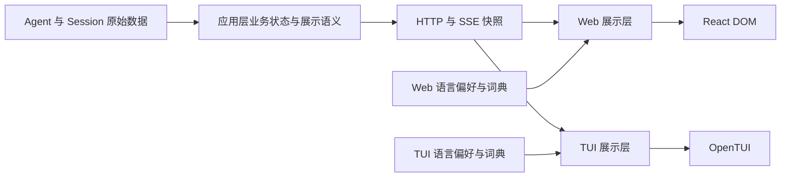

# AlphaCode 国际化技术设计

> 状态：首轮实现已落地，实施记录见第 13 节。调研及实施日期：2026-11-10。适用范围：AlphaCode Web、CLI 与 TUI。调研基线：`d24650c` 及调研时工作区中的现有改动。

AlphaCode 建议采用 **i18next + react-i18next 作为运行时，JSON 作为词典格式，x18n 作为文案维护工具，i18next-cli 负责词典类型生成**。首发支持简体中文与英文，用户可选择跟随系统。翻译在客户端展示时完成，共享服务端继续传递与语言无关的状态和数据。

本方案最关键的改造是把已进入会话状态的固定文案改为可识别的业务语义。这样，同一会话可以在中文 Web 和英文终端中同时使用，切换语言也不会改变模型上下文、历史记录或正在执行的任务。

## 1 设计决策

| 项目 | 建议决策 | 原因 |
| --- | --- | --- |
| 运行时 | 两端统一使用 i18next；React 展示层使用 react-i18next | 可在浏览器、普通 TypeScript 和 React 中使用，不要求应用增加宏转换步骤 |
| 文案维护 | x18n 先试点，验证通过后接入检查流程 | 接入 antfu 的新工具，同时将其与生产运行时隔离 |
| 词典 | UTF-8 JSON，按应用、语言、业务命名空间组织 | 方便审查、工具处理和未来接入翻译平台 |
| 类型 | 稳定语义 key + 基于英文词典生成的声明 | 检查 key、命名空间和插值参数，避免另外手工维护类型 |
| 首发语言 | `en`、`zh-CN`；源语言及最终回退语言为 `en` | 面向开发者的命令与诊断已有英文基础，统一词典基准 |
| 默认偏好 | `system`，用户选择优先 | 中文环境首次展示中文，英文环境展示英文 |
| 所有权 | 两个应用分别持有词典和运行时实例 | 保留现有 Web 与内部包隔离的依赖边界 |
| 加载 | V1 将本应用两种语言的词典随应用打包 | 支持离线，避免切换语言引入网络请求、加载失败与界面重挂载 |
| 会话与协议 | 传输业务 code、参数和原始内容；展示层翻译 | 支持多客户端使用不同语言；不把翻译 key 变成服务端协议 |
| 暂缓范围 | 模型回复翻译、文档站多语言、SEO 路由、远程词典、翻译 SaaS、完整 RTL | 当前首要目标是本地开发工具的双语界面 |

这些是本项目的选型判断。库的公开能力与项目适配理由见第 3 节；具体依赖版本在实施试点通过后固定到各包和根目录唯一的 `bun.lock`。

## 2 当前项目的约束

### 2.1 技术栈和接入位置

| 当前事实 | 设计影响 | 仓库依据 |
| --- | --- | --- |
| Bun workspace + Nx；Web 使用 React 19、Vite 8 和 React 插件 | 保持现有包管理和构建方式 | [根 package.json](C:/Users/ziyang/project/alpha/package.json)、[Web package.json](C:/Users/ziyang/project/alpha/apps/alphacode-web/package.json) |
| CLI 使用 Bun 原生 JSX 和 OpenTUI React；生产构建由 Bun.build 完成 | 宏方案需要额外验证终端构建路径；React DOM 组件不可直接用于终端 | [CLI 构建入口](C:/Users/ziyang/project/alpha/apps/alphacode/scripts/build.ts) |
| Web 的 ESLint 规则禁止导入 `@alpha/**`、Bun、Node 和 CLI 内部模块 | V1 不新增跨端共享运行时包，也不为国际化放宽这些规则 | [依赖边界](C:/Users/ziyang/project/alpha/eslint.config.js) |
| Web 已有 Query 与 Theme Provider，并处理 localStorage 不可用的情况 | 语言 Provider 可采用类似的应用级生命周期 | [应用 Provider](C:/Users/ziyang/project/alpha/apps/alphacode-web/src/components/providers.tsx)、[主题 Provider](C:/Users/ziyang/project/alpha/apps/alphacode-web/src/components/theme-provider.tsx) |
| Web 中文硬编码分散在 JSX、错误映射、默认标题和辅助文本中 | 扫描需覆盖普通文本、属性、工具函数和状态初始化 | [Web 入口](C:/Users/ziyang/project/alpha/apps/alphacode-web/src/app.tsx)、[API 投影与错误映射](C:/Users/ziyang/project/alpha/apps/alphacode-web/src/features/sessions/api.ts)、[会话投影](C:/Users/ziyang/project/alpha/apps/alphacode-web/src/features/sessions/types.ts) |
| TUI 的英文文案既在组件里，也在 controller、runtime 中 | 不能只替换组件里的字符串 | [状态组件](C:/Users/ziyang/project/alpha/apps/alphacode/src/ui/components/composer-status.tsx)、[会话 controller](C:/Users/ziyang/project/alpha/apps/alphacode-app-server/src/chat/controller.ts) |

### 2.2 需要先处理的数据问题

当前 `ChatState.status` 混合了固定英文提示和工具描述；`ChatMessage.note` 也可能直接保存英文。服务端快照将这些内容发给各客户端，TUI 还存在与 `"Ready"` 比较的展示逻辑。应让业务判断依赖 `phase`、运行结果、工具状态和业务 code，固定文案留到渲染时生成。[Chat 数据契约](C:/Users/ziyang/project/alpha/apps/alphacode-app-server/src/chat/contracts.ts)、[状态投影](C:/Users/ziyang/project/alpha/apps/alphacode-app-server/src/chat/messages.ts)、[服务端快照](C:/Users/ziyang/project/alpha/apps/alphacode-app-server/src/server/server.ts)

工具记录已有 `descriptionSource: model | fallback`，可以区分模型描述与应用生成的描述。不过 Web 自有投影尚未声明这个字段和 `target`，实施时应补全。`Run command: …`、`File updated.`、省略行标记等应用生成内容也需要独立于工具原始输出处理。[工具记录投影](C:/Users/ziyang/project/alpha/apps/alphacode-app-server/src/runtime/tool-records.ts)

当前工作区的 Web 代码已包含发送、审批和实时连接逻辑，README 的部分描述仍停留在只读历史阶段。迁移清单应以实施时的源码为准，将这些新增流程一并纳入文案盘点。

## 3 社区方案与 antfu 的近期工作

### 3.1 antfu 的 x18n

antfu 近期相关项目是 **x18n**。官方仓库将它定位为 i18n Ally 的后继工具，提供跨框架的词典检查、引用查找、过期译文检测，以及 CLI、UI 和编辑器集成。它适合维护词典，可以与 i18next 等运行时配合。[x18n 官方仓库](https://github.com/x18n-dev/x18n)

官方包信息显示作者为 Anthony Fu，当前属于 `0.1.x` 阶段，CLI 声明 Node `>=22`。因此，项目的 Bun 1.4.4 执行路径需要实际验证，不能由“TypeScript 工具”推断为已经兼容。[x18n CLI 包声明](https://github.com/x18n-dev/x18n/blob/main/packages/cli/package.json)

对 AlphaCode 的采用方式：x18n 只进入开发工具链，先扫描两个应用，验证命名空间、复数和参数检查，再决定是否升级为阻断检查。运行时及词典格式均不依赖 x18n；工具异常时应用仍可构建和运行。其 Agent 集成后续可用于提出翻译改动，译文仍通过普通 Git diff 审查。

### 3.2 运行时方案比较

以下覆盖 React 社区常见的运行时、ICU 和编译器路线。项目适配结论依据双客户端、Bun 构建和现有依赖边界作出，不是市场份额排名。

| 方案 | 官方能力与路线 | 对 AlphaCode 的判断 |
| --- | --- | --- |
| **i18next + react-i18next** | 命名空间、语言回退、复数、React hooks/context、类型扩展 | **首选**。Web 和非 DOM 的终端展示可使用同一消息模型，业务代码无需宏转换；需约束动态 key 和字符串拼接。[类型](https://www.i18next.com/overview/typescript)、[React Provider](https://react.i18next.com/latest/i18nextprovider) |
| **Lingui** | 消息提取、ICU、目录编译、React 集成；当前 Vite 插件支持原生宏转换 | **强备选**。适合重视源码内文案和翻译提取的团队；本项目还需验证 Bun/OpenTUI 这条构建路径。不能以“必须加 Babel”为由排除，它已有 Vite 8 原生方案。[Lingui](https://lingui.dev/)、[Vite 插件](https://lingui.dev/ref/vite-plugin) |
| **FormatJS / React Intl** | ICU 消息表达及格式化工具，React 集成 | 适合复杂复数、选择分支和专业翻译流程。可覆盖本项目，但简单操作与状态文案目前占主导，优先采用 i18next 的键值模型。[React Intl](https://formatjs.github.io/docs/react-intl/)、[ICU 语法](https://formatjs.github.io/docs/core-concepts/icu-syntax/) |
| **Paraglide JS** | 将词典编译为带类型的消息函数，支持 tree-shaking 和 React + Vite | 适合明确要求编译期消息函数与包体优化的场景；需增加代码生成，并验证终端加载及无刷新切换。当前缺少足以驱动这一选择的项目性能数据。[React + Vite 指南](https://paraglidejs.com/react) |
| **next-intl / use-intl** | next-intl 面向 Next.js；独立的 use-intl 可用于普通 React 和 JS | 可以用 use-intl，项目无需为国际化引入 Next.js。对于当前双端结构，没有优于首选方案的明确收益。[官方核心库说明](https://next-intl.dev/docs/environments/core-library) |
| **自建字典函数** | 自行维护查找、参数和回退 | 需要继续补齐复数、类型和工具生态，不建议承担这部分维护成本 |

### 3.3 工具分工

**i18next-cli** 用于生成包含消息字面量的类型声明；其官方 `types --ci` 提供只检查、不写入的生成物一致性检查。x18n 负责维护体验与质量报告，避免两套工具同时自动改写词典。[i18next-cli 官方说明](https://github.com/i18next/i18next-cli)

源词典和译文只由开发者或经过审查的翻译改动维护。自动提取可以提出 key，但不得覆盖已有文案、自动删除疑似未使用项，或把空值当成翻译完成。早期无需引入 Crowdin、Lokalise、Tolgee 等外部平台；需要多人翻译协作时，再在 JSON 和 Git 工作流之外增加服务。

## 4 国际化范围

| 内容 | V1 处理方式 |
| --- | --- |
| 页面标题、导航、按钮、空态、占位文字、连接状态 | 全部进入词典 |
| aria-label、title、sr-only、复制反馈、快捷键说明 | 与可见文案一起迁移 |
| 审批按钮、权限模式名称、操作后果提示 | 翻译并人工审核语义，保持实际权限与行为不变 |
| CLI 帮助、启动和配置错误、TUI 内置命令说明 | 纳入双语；启动失败使用独立的最小展示路径 |
| 工具状态、应用生成的工具摘要、消息完成提示 | 从结构化状态生成本地化文案 |
| 用户输入、模型回复、模型生成的工具描述 | 保留原文 |
| 用户会话标题、项目名、路径、命令、代码、stdout/stderr | 保留原文，允许本地化周围的说明 |
| API 字段、错误 code、状态枚举、数据库键 | 保持稳定机器标识 |
| 模型 system prompt、工具 schema 描述、Skill 原文、AGENTS.md 内容 | 保持现有内容；界面语言不参与这些内容的生成 |
| `/web`、`/permission`、`/skills`、Skill 调用名 | 命令标识不变；只翻译应用维护的说明文字 |
| README、开发设计文档、第三方异常正文 | 不属于首发界面翻译范围 |

“界面语言”与“希望模型使用的回答语言”是独立概念。切换到英文界面不应自动给当前会话追加英文指令，也不应重写历史消息。将来若增加回答语言偏好，应另行设计其会话语义。

## 5 模块组织与运行时

### 5.1 目录建议

以下均为拟新增位置，不代表本次已经创建这些模块。

```text
apps/alphacode-web/src/i18n/
  instance.ts                 应用实例工厂和词典注册
  locale.ts                   浏览器偏好及语言解析
  provider.tsx                语言状态和切换
  format.ts                   数字、日期和耗时展示
  resources.d.ts              从源词典生成
  i18next.d.ts                本应用的类型扩展
  locales/en/                 common、workspace、sessions、tools、settings、errors
  locales/zh-CN/              对应命名空间

apps/alphacode/src/i18n/
  instance.ts                 无 React、无 DOM 的实例工厂
  locale.ts                   CLI 参数、环境与配置的解析
  format.ts                   终端格式化
  resources.d.ts
  i18next.d.ts
  locales/en/                 common、cli、chat、tools、permissions、skills、errors
  locales/zh-CN/              对应命名空间

apps/alphacode/src/ui/i18n-provider.tsx
                              OpenTUI React 绑定
docs/i18n-glossary.md          后续维护的中英术语表
```

根目录负责汇总检查；每个应用独立配置词典扫描和类型生成，明确输入目录、源语言、目标语言及命名空间。英文和中文目录中每个命名空间对应一个 JSON 文件，不为单个组件建立文件。

暂不创建 `@alpha/i18n`。跨端共享的是语义约定、术语和验收标准；同义按钮少量重复可以接受。出现第三个客户端或持续的大量同义消息后，再评估只含纯数据和类型的共享包，并单独评审 Nx 与浏览器依赖规则。

### 5.2 数据流



每个应用挂载、TUI 进程及测试用例持有自己的 i18next 实例，禁止通过共享单例让一个测试或客户端的语言影响另一个。React 层使用显式 `I18nextProvider` 传递实例。[实例传递机制](https://react.i18next.com/latest/i18nextprovider)

服务端、ADK、Provider、Session 和 Coding Agent 不导入翻译运行时。应用层的 controller/runtime 可以产生业务 code 或结构化展示数据，但不读取客户端语言。

### 5.3 加载与发布

V1 静态打包两种语言，挂载前完成实例初始化，避免在活动会话树上因词典加载而触发 Suspense。TUI 只使用字符串翻译和 hooks/context，不使用会生成 DOM 标签的富文本组件。OpenTUI 的实际兼容性在 P0 试点验证；若绑定不兼容，终端用应用内薄 React Context 订阅 i18next，保持相同词典格式。

所有资源随应用版本发布，不依赖 CDN、翻译服务或联网请求。实施时测量词典及运行时对 Web 压缩产物、TUI 启动的增量；出现实际瓶颈后，再按语言或大功能拆分资源。不能直接套用其他方案的官方示例包体数字作为本项目性能结论。

## 6 消息格式与类型约束

### 6.1 key 与命名空间

采用语义 key，例如 `sessions:empty.title`、`tools:activity.count`、`errors:sessionNotFound`。冒号分隔命名空间，点号对应 JSON 内的嵌套对象；避免同时维护带点的扁平键和嵌套键。

key 表达业务用途，不以中文、完整英文句子、组件行号或 UI 位置命名。修改措辞时保持 key；业务语义改变时新建 key。同一个英文词在不同语境中含义不同，应使用不同 key，例如“关闭面板”和“关闭会话”。

状态枚举到 key 的转换使用显式、穷尽的映射。禁止把服务器字符串直接拼成翻译 key，也不调用 `t(error.message)`。未知 code 映射到通用提示，原始 code 单独作为诊断信息展示。

### 6.2 插值与复数

V1 使用 i18next 原生消息语法：`{{name}}` 插值及 `_one`、`_other` 等复数后缀。复数调用必须提供数值型 `count`；所需类别由目标语言决定，中文无需机械复制英文的 `_one`。[i18next 复数规则](https://www.i18next.com/translation-function/plurals)

| 消息 | 英文词典示意 | 中文词典示意 |
| --- | --- | --- |
| 继续会话 | `Continue {{title}}` | `继续 {{title}}` |
| 工具数量的单数形式 | `activity.count_one` → `{{count}} tool action` | 不要求此分支 |
| 工具数量的其他形式 | `activity.count_other` → `{{count}} tool actions` | `activity.count_other` → `{{count}} 项工具活动` |
| 允许执行工具 | `Allow {{toolName}} to run?` | `允许执行 {{toolName}}？` |
| 创建结果不确定且草稿保留 | 一条完整消息，表达结果未知、保留草稿和下一步操作 | 对应完整中文消息 |

不拼接“数量 + 单位 + 状态”等句子片段。当前工具摘要里的 `${count} 项${label}`，以及创建失败提示后再拼接“草稿已保留”的方式，都需要改成完整消息。独立状态徽标可以单独翻译，多个独立徽标之间的视觉分隔符无需进入句法拼接。

首发不同时启用 ICU 和 i18next 原生语法。确有复杂嵌套语法需求时，再对消息格式整体作出决定，避免同一词典中混用两种表达。

### 6.3 类型安全

使用**带类型的字符串 key**作为 V1 的统一调用方式。i18next 当前官方文档明确保留字符串 API，selector 是可选项；本项目先保证扫描可识别性和 tsrs 兼容性，不把 selector 作为前置要求。[i18next TypeScript 说明](https://www.i18next.com/overview/typescript)

仅从 JSON 导入对象形状，不能保证插值变量的字面量类型推导。采用 i18next-cli 从英文词典生成资源声明，再由各应用自己的 `i18next.d.ts` 扩展类型。声明只包含本应用命名空间，避免两个 tsconfig 中的全局扩展相互污染。[JSON 与插值类型限制](https://www.i18next.com/overview/typescript)、[声明生成工具](https://github.com/i18next/i18next-cli)

类型验收必须证明：不存在的 key、缺失必填插值、缺失复数 count 会失败；正常字符串、数字和复数调用通过。参数的业务类型仍由调用点或领域类型约束，不能把占位符识别等同于完整业务数据校验。固定版本时显式启用该版本支持的严格 key 与插值检查，并在仓库使用的 tsrs 和 TypeScript 工具链下验证。

生成的声明提交到仓库，开发时可自动更新，检查阶段只比较是否过期，不修改文件。

### 6.4 文本渲染

Web 译文默认作为 React 文本节点或属性值输出，不送入 HTML 或 Markdown 解释器；富文本确有必要时，使用由组件控制的有限占位节点。TUI 译文输出普通字符串，动态路径、命令和外部文本继续使用现有终端控制字符清理。

i18next 默认会转义插值；React 文本渲染路径可关闭它的 HTML 转义以避免双重转义，但此约定仅适用于安全文本输出，不能扩展到 `innerHTML`。终端的控制字符处理与 HTML 转义是两件事。[i18next 插值与转义](https://www.i18next.com/translation-function/interpolation)

## 7 语言选择与回退

### 7.1 偏好模型

区分三个值：用户偏好 `system | en | zh-CN`，实际词典语言 `en | zh-CN`，以及数字日期所用的 `formatLocale`。`system` 是偏好，不是词典目录。

| 输入 | 词典语言 | 格式化规则 |
| --- | --- | --- |
| 显式 `en` | `en` | V1 固定为 `en-US` |
| 显式 `zh-CN` | `zh-CN` | `zh-CN` |
| 自动检测到 `en-GB` 等英文区域 | `en` | 保留有效且受运行时支持的区域，例如 `en-GB` |
| 自动检测到 `zh-Hans`、`zh-CN`、`zh-SG` | `zh-CN` | 使用有效地区；仅有书写系统时采用 `zh-CN` |
| 只有 `zh` | `zh-CN` | 将裸中文代码解释为首发简体中文，这是一项产品规则 |
| 自动检测到 `zh-Hant`、`zh-TW`、`zh-HK`、`zh-MO` | 继续寻找候选；无匹配则 `en` | V1 不提供繁体，语言菜单始终可手动选择简体 |
| 非支持语言或无有效语言 | `en` | `en-US` |

解析先保留明确的 script 信息，`zh-Hant-CN` 等组合不能只按地区映射为简体。操作系统 locale 的下划线和编码后缀仅在解析环境输入时规范化，例如 `zh_CN.UTF-8`。`C`、`POSIX` 和 `C.UTF-8` 视为确定的英文环境。

### 7.2 Web 偏好

优先级为：**当前显式选择或有效 localStorage 偏好 → `navigator.languages` 中第一个支持的语言 → 英文**。选择 `system` 后重新按浏览器语言列表解析，不保留上一次手动语言作为隐式覆盖。

建议使用版本化存储键 `alphacode-language-v1`。只接受白名单值；损坏内容按 `system` 处理。localStorage 不可用时保留内存选择；同源其他页签通过 storage 事件同步；跟随系统时监听浏览器 languagechange。切换后更新 `<html lang>`、`dir` 以及可访问名称。

语言偏好不进入 Session 查询键，不改变 `?session=`，不触发历史重新请求、SSE 重连、消息重发或 QueryClient 重建。Provider 不能以 locale 作为整棵应用树的 React key。

**持久化边界：**当前本地 server 的 origin 包含端口，端口变化会形成不同的 localStorage 空间。因此 V1 只承诺同源记忆，不承诺 server 重启换端口后仍记住偏好，也不承诺与 CLI 同步。若需要跨端口持久化，应另行设计用户偏好存储接口，不能复用会话语言或放宽现有本地访问规则。

### 7.3 CLI 与 TUI 偏好

拟支持 `--lang`、`ALPHACODE_LANG` 和全局配置中的 `language`，值为 `system | en | zh-CN`。优先级：

1. 本次启动的 `--lang`。
2. `ALPHACODE_LANG`。
3. 用户全局配置 `language`。
4. `LC_ALL` → `LC_MESSAGES` → `LANG` 的第一个有效非空系统 locale。
5. 运行时可识别的系统语言，最后为英文。

前三层任一层显式选择 `system`，立即进入系统检测，不再使用较低层的应用偏好。显式参数、环境变量或配置中的非法枚举应报告配置错误；系统检测结果无法匹配则回退英文。

V1 的终端语言在启动时确定，配置修改在下次启动生效；不增加 `/language` 命令。语言参数仅改变本次客户端展示，不能把它透传为共享 server、Agent 或 Session 的语言设置。

`--help`、参数错误和配置文件读取失败发生得早，应使用不依赖 OpenTUI、server、数据库和完整配置成功读取的最小启动词典。全局配置不可读时，用已解析的参数、环境或系统语言展示错误；不得为了显示错误再次读取失败的配置。`--version` 保持机器可识别的品牌与版本输出。

### 7.4 运行时回退

明确设置支持语言与 `fallbackLng = en`；在应用层完成中文 script 匹配后，只向运行时传入规范的词典语言。词条回退顺序为“当前语言的目标命名空间 → 英文同命名空间”，不启用跨业务命名空间的隐式回退。[i18next 回退机制](https://www.i18next.com/principles/fallback)

空字符串视为缺失。开发与检查流程阻断缺 key；生产出现缺失时优先显示英文并输出去重诊断，不写入用户词典、不调用在线翻译。两种语言都缺失时，以可追踪的缺失标记暴露问题；审批等关键操作若缺少能准确表达含义的必要文案，应禁用该操作并给出内置通用提示。

## 8 展示状态与协议迁移

### 8.1 保持语言无关的状态

优先复用现有 `phase`、`ToolStatus`、`completion.status`、权限枚举和 HTTP 错误 code。只有现有字段无法表达的信息才增加语义字段。以下字段名称为设计建议，code 必须表达业务事实，而非 `chat.status.ready` 这样的词典路径。

| 当前内容 | 建议数据与展示责任 |
| --- | --- |
| `ChatState.status` 内的 Ready、Run failed、Saving 等 | 由 `phase`、`closing`、`approval` 和拟新增的 `lastRunStatus` 确定展示；运行中的工具描述单独读取 |
| `ChatState.error` 中混合 code 与英文句子 | 增加可选 `notice`，包含稳定业务 code、等级和经过约束的参数；客户端映射到 `errors` 命名空间 |
| `ChatMessage.note` 中的 Incomplete preview 等 | 增加可选 `noteCode`，保留旧 note 作为兼容信息；已知语义在当前语言下展示 |
| 工具的 fallback description | 使用已有 `descriptionSource`、工具名、`target/path/command` 重建摘要；`model` 来源直接展示原文 |
| File updated、File created 等应用生成结果 | 增加可识别的结果摘要语义，客户端生成说明；原始工具结果不变 |
| 工具输出中插入的省略行英文 | 新展示投影区分内容片段与省略数量，客户端渲染分隔提示；不对原始输出全文替换 |
| `/skills` 的整个英文 localText | 提供应用级结构化本地命令结果，含技能列表、诊断 code 和参数；客户端翻译栏目与使用提示，技能描述保留原文 |

`notice` 参数只包含该提示确实需要的标量，例如数量、路径或 code，不包含整个异常对象。新客户端先使用结构化语义，缺失时展示兼容的英文说明或通用提示，不用英文字符串匹配推断业务状态。

### 8.2 兼容与历史数据

当前协议版本为 2。首轮采用**可选字段的增量扩展**，保留旧 `status`、`error`、`note` 等字段的原有含义；新增字段不要求旧客户端识别。发布前验证旧客户端与新 server、新客户端与旧 server 的组合。只有删除旧字段或改变既有字段语义时，才另行提升协议版本并按照现有生命周期机制要求重启。[协议声明](C:/Users/ziyang/project/alpha/apps/alphacode-app-server/src/server/protocol.ts)、[版本检查](C:/Users/ziyang/project/alpha/apps/alphacode-app-server/src/server/lifecycle.ts)

历史恢复路径已根据归档事件构建展示记录，应优先在该投影处恢复状态语义，不迁移数据库中的自然语言正文。无法从旧记录可靠恢复的内容按原文展示，不能将所有等于某个英文短语的历史消息都当作系统文案替换。[历史恢复](C:/Users/ziyang/project/alpha/apps/alphacode-app-server/src/runtime/history.ts)

新 Web 的自有 API 投影与 TUI 契约同步维护；Web 仍不直接导入 CLI 文件。语言切换不触碰 `requestId`、`approvalId`、`sequence`、事件去重和工具执行状态。

### 8.3 避免文案冻结在缓存中

Web 的 `sessionSummary` 当前把“未命名会话”“已保存的会话”写入视图对象。本地草稿也直接使用“新会话”作为标题。应改为保留原始标题及本地草稿身份，在渲染处决定 fallback 和辅助说明。

错误状态保存错误 code、参数或领域错误对象，不提前调用翻译函数保存字符串；`useMemo` 等派生展示在语言变化时重新计算。模块顶层的菜单数组保存 key 或语义标识，避免模块加载时翻译后永久固定语言。

用户真正输入、首条消息派生或服务端保存的会话标题属于用户内容，切换语言不重命名。服务端的 `AlphaCode` 默认品牌标题也不依靠字符串猜测来替换。

## 9 数字日期与界面布局

数字、日期、相对时间优先使用平台 `Intl`；i18next 也提供基于 Intl 的内置格式化器。项目的格式化入口统一接收 `formatLocale` 和明确的业务选项，避免组件自行决定规则。[i18next 格式化](https://www.i18next.com/translation-function/formatting)

| 数据 | 规则 |
| --- | --- |
| 时间点 | 协议和持久化继续保存现有时间戳或 ISO 时间；客户端按本地时区格式化 |
| 耗时 | 从毫秒数计算，沿用单调时钟的运行计时；紧凑的 s/m/h 可作为统一符号，完整说明进入词典 |
| 数量与 token | 以数值传递；分组、缩写由格式化器决定；复数选择继续使用原始 count |
| 相对时间 | 使用统一阈值和 `Intl.RelativeTimeFormat`，明确何时刷新，避免每条消息各开高频定时器 |
| 货币 | 将来增加费用时由业务显式提供 currency，不从界面语言推断 |
| 路径、hash、模型 ID、命令和代码 | 不加本地化分隔符、不改变大小写、不重写内容 |

TUI 当前的 `en-GB` 时间格式实例位于模块顶层，应移动到实例或按 locale/选项缓存的格式化入口。V1 无需强制依赖 `Intl.DurationFormat`；基础时间单位和双语消息已能覆盖现有耗时显示。

布局验收包括中文宽字符、英文长文案、emoji、组合字符和长路径。终端截断依赖实际显示宽度，不能用字符串长度估算；Web 测试窄屏、弹出菜单、审批区和无障碍名称。语言菜单用“简体中文”“English”“跟随系统”等文字，不用国旗表示语言。

首发两个语言均为 LTR，Web 设置 `dir=ltr` 并在新增布局中优先使用逻辑方向属性；这不等于已经支持 RTL。新增 RTL 语言时需要单独检查 Web 和终端的双向文本能力。

## 10 词典维护与自动检查

### 10.1 日常工作流

1. 开发者新增语义 key、英文源文案、使用场景和参数说明，并补齐简体中文。
2. 生成资源声明，检查所有调用的 key 和参数。
3. 运行按应用配置的词典检查，审查未使用项和源文案变动。
4. 人工核对双语效果，特别是审批、权限、失败和结果不确定等提示。
5. 将代码、词典、类型生成物和需要更新的术语一起提交。

英文源文案改变而 key 不变时，中文也必须重新审核；“目标语言存在相同 key”不能证明译文仍准确。以源消息版本或 hash 记录审核基准。若 x18n 的固定版本不能可靠覆盖此流程，PR 检查必须根据源词典变更列出待复核译文。

术语建议统一为：session＝会话，workspace＝工作区，tool＝工具，approval＝审批，permission＝权限，draft＝草稿；Skill 保留产品术语或在首次出现时加解释。不同权限模式的译文必须准确表达当前实现，不能因为名称变得友好而弱化执行范围。

### 10.2 x18n 试点要求

将 Web 与 CLI/TUI 视为两个独立项目，显式配置扫描根目录；不得依赖 monorepo 根目录的零配置推断。验证 TSX 属性、普通 TypeScript、显式映射、命名空间与复数能够被正确识别。

先在固定的少量样例上校验报告：故意缺失中文、参数拼错、源文案修改、未使用 key，以及合法的中文 `_other`。确认结果和退出码后才接入阻断流程。重点验证检查器不会把中文缺少英文 `_one` 当成错误，也不会把未扫描到的间接引用直接认定为可删除项。

固定 x18n 版本，并验证其在 Windows 和项目 Bun 版本下的 CLI 路径。若需要 Node 才能运行，应记录为开发工具兼容性决策；在团队继续维持 Bun-only 的情况下，暂不把 x18n 设为发布依赖，改用通过兼容性验收的 i18next-cli 检查及必要的小范围资源校验。应用运行时选型不随此变化。

### 10.3 检查级别

| 检查 | 处理方式 |
| --- | --- |
| 源词典中不存在被调用的 key；未通过类型检查 | 阻断 |
| 已迁移且对用户开放的消息缺中文、空译文、重复 JSON key | 阻断 |
| 必填参数缺失、参数名不一致、目标语言必需复数类别缺失 | 阻断；按消息语义与语言类别检查，不做机械键集合相等比较 |
| 类型声明与源词典不一致 | 阻断，检查模式不得自动修复 |
| 关键审批与权限提示的源文案已改变但译文未复核 | 阻断 |
| 普通消息的译文过期 | 迁移期间告警；迁移完成后纳入阻断 |
| 疑似未使用 key | 先告警并人工确认，不自动删除 |
| 新增硬编码用户文案 | 已迁移目录阻断；历史未迁移目录建立可缩减的清单 |
| 路径、测试夹具、命令、协议标识等扫描例外 | 明确目录或规则与原因；禁止用大范围忽略掩盖真实文案 |

硬编码检查需覆盖中英文、JSX 属性和普通 TS；仅用“查找中文字符”的正则不能验收国际化。若现有工具无法可靠检查某种调用形式，应简化调用约定或增加针对性检查，不能默认工具已经支持。

仓库目前未配置 CI；首轮把检查接入本地 Bun/Nx 命令，未来流水线执行同样的只读任务。Nx 的输入应包含两种语言词典、检查配置、生成声明和源代码，避免改了中文却命中旧缓存。翻译生成与联网操作不得成为普通测试的隐式步骤。

## 11 实施阶段与验收

以下保留阶段验收计划；首轮实现、已验证项目与剩余验收边界见第 13 节。

| 阶段 | 内容 | 退出条件 |
| --- | --- | --- |
| P0 兼容性试点 | 固定候选版本；验证 Web、Bun/OpenTUI、类型生成与 x18n；用按钮、复数、插值错误、状态提示作为样例 | 两端生产构建与启动成功；类型负例确实失败；词典检查能区分真实错误与合法复数差异 |
| P1 Web 静态界面 | Provider、语言菜单、两套词典、ARIA、空态、复制和主题菜单；清理在缓存中冻结的文案 | 可即时切换；草稿、附件、当前会话、工具展开状态和已有消息保持；未迁移共享状态明确记录 |
| P2 共享展示语义 | 状态、提示、note、fallback 工具摘要、本地命令结果的结构化投影；兼容旧字段 | 中英文两个客户端查看同一活动会话，各自正确展示；运行、取消、审批、重连与历史恢复行为不变 |
| P3 CLI 与 TUI | 启动语言解析、帮助与错误、内置命令说明、权限和工具界面、时间显示 | 干净启动与构建产物均支持双语；配置损坏仍有可读提示；中文与英文终端宽度测试通过 |
| P4 收口 | 完成源词典、译文审校、术语、伪本地化、检查任务与回归 | 首发范围双语覆盖完整，关键译文已复核，阻断规则生效，无未解决的主要布局问题 |

阶段性合并允许，但完成 P1 不代表整个产品已经国际化。正式宣布双语支持以 P4 验收为准。

### 11.1 核心验收场景

| 场景 | 必须满足的结果 |
| --- | --- |
| Web 英文和 TUI 中文同时连接同一会话 | 各自界面语言正确，服务端状态与消息原文一致 |
| Web 正在生成、重连或等待审批时切换语言 | 不新建请求、不重发消息、不回答审批、不重置 SSE 游标和草稿 |
| 切换语言后查看先前的加载失败和工具结果 | 应用生成提示更新；外部原始内容保持 |
| 禁用 localStorage 或写入损坏偏好 | 可以切换并继续使用；恢复到明确的默认规则 |
| 中文系统、英文系统、C locale、繁体偏好及未知语言 | 按第 7 节规则选择；非法显式配置得到错误 |
| 数量为 0、1、2，插值包含中文路径、尖括号和花括号 | 复数正确；参数作为数据展示；无二次模板执行或转义残留 |
| 旧 server 或旧历史缺少语义字段 | 能使用兼容提示或原文；不靠猜测改写历史 |
| 伪本地化将文案扩展约 30% 至 50% | 检查菜单、状态栏、窄屏和审批布局；不修改用户内容及占位符 |
| 从生产构建目录离线启动 | 两种语言词典均可用，不依赖仓库外文件或远程词典 |
| 修改英文后没有重新审核中文 | 能被变更审查或检查任务发现，不能由运行时英文回退掩盖 |

自动化测试以状态、语言解析、复数、类型负例和跨客户端隔离为主。Web 复用 Vitest 与 React Testing Library，TUI 复用 Bun 测试及现有渲染测试；不为每一句静态译文建立脆弱快照。视觉检查覆盖代表性页面和终端尺寸，翻译审校由人完成。

### 11.2 回退与交付边界

词典问题可随普通补丁发布；必要时临时固定使用完整英文词典，数据格式和执行逻辑保持不变。x18n 误报可以退回已经验证的资源与类型检查，不能关闭所有翻译质量检查。

协议扩展在迁移期保留旧字段，撤回新客户端不会要求数据库回滚。移除旧字段、引入共享 i18n 包、远程翻译分发或新增第三种语言，都属于后续独立变更。

## 12 后续重新评估的条件

当团队希望直接在源码中维护自然语言消息，并愿意统一两端提取和编译流程时，重新比较 Lingui；当实测包体或首次加载成为瓶颈时，重新比较按需加载与 Paraglide；当消息结构出现大量复杂选择和嵌套复数时，重新评估 ICU；当翻译人员需要独立协作、术语库和审核权限时，再引入翻译平台。

当前阶段先完成可验证的双语展示、语言无关的共享状态和可维护的词典流程。这三项决定国际化能否持续迭代，工具选择围绕它们展开。


## 13 首轮实施记录（2026-11-10）

### 13.1 已接入的能力

- 固定运行时 `i18next@27.0.1`、`react-i18next@18.0.1`，开发工具 `i18next-cli@1.87.0`、`@x18n/cli@0.1.13`。均通过本机 Windows + Bun 1.4.4 验证。工具包声明的 Node 引擎要求不代表其所有子命令已在 Bun 下验证；本次覆盖的是离线检查、类型生成和下述负例。
- 两个应用分别拥有 `src/i18n/`、按语言与 namespace 拆分的 JSON 和独立 Provider。语言均随产物静态打包。服务端、对话控制器和 runtime 不创建翻译实例。
- Web 侧栏增加语言菜单，支持 `system`、`en`、`zh-CN`，写入 `alphacode-language-v1`；更新页面 `lang`/`dir`，支持跨标签页和系统语言变化。会话标题 fallback、已有错误、工具状态和内置命令结果在渲染时翻译。
- CLI 支持 `--lang=en` / `--lang zh-CN`、`ALPHACODE_LANG` 和全局 YAML 的 `language`。优先级遵循第 7 节。帮助支持源码启动器和构建入口，不启动服务器，不初始化配置；损坏配置不会阻止帮助输出。
- TUI 的欢迎、命令选择、审批、工具、完成时间和连接提示使用当前实例的语言。`Intl.DateTimeFormat` 按 locale 缓存；命令、路径、用户输入、模型回复及模型提供的工具描述保持原文。
- 协议维持版本 2，增加可选 `notice`、`lastRunStatus`、`noteCode`、`localResult`、工具 `summaryCode`/`errorCode`/`outputLines` 等展示字段。保留旧文本供旧客户端使用；历史恢复按事件恢复语义，未迁移数据库正文。

### 13.2 开发与检查命令

在仓库根目录运行：

```sh
bun run i18n:types
bun run i18n:check
bun run typecheck
bun run lint
bun run build
```

`i18n:check` 先运行固定版本 x18n 的负例试点，再运行两个应用的 Nx `i18n-check`。检查包括缺失/空译文、重复 JSON key、参数不一致、语言所需复数、生成类型是否过期、JSX 文本与属性、普通 TS 的疑似硬编码，以及词典审核版本。检查过程不修改文件、不联网翻译。

`test/i18n-types.ts` 的编译负例要求未知 key、缺少插值参数、参数拼错被类型系统拒绝。删除类型保障会使 `@ts-expect-error` 失效，从而使 typecheck 失败。

修改词典的流程：先修改英文与中文 → 运行 `bun run i18n:types` → 对照产品语境审核两种语言 → 在对应应用目录运行 `bun run i18n:review` → 根目录运行 `bun run i18n:check`。`src/i18n/review.json` 保存两套词典每个 namespace 的配对 hash；英文措辞改变而 key 不变也会使检查失败。该记录是版本基准，不替代译者或产品负责人的人工批准。

每个应用的 `bun run i18n:report` 可查看原始 x18n 报告。显式映射的间接 key 仍存在未使用误报，只告警，不自动删除。普通 TS 扫描也会识别 SQL、Tailwind 变体和协议兼容文本；`src/i18n/hard-string-exceptions.json` 按文件、确切消息和理由列出已审查的例外。检查脚本将不在该清单中的新硬编码提升为错误。更新例外前需要确认内容确实不是用户文案，不能整体忽略 UI 目录。扫描工具是启发式检查，不能代替代码审查。

Nx 输入包含应用源码、全部词典和生成物、配置、根检查脚本及 lockfile；翻译生成和审核记录命令不会隐式进入 build/test。

### 13.3 自动化验收与发布边界

已增加并运行：语言优先级与地区规范化、繁体中文回退、0/1/2 复数、插值特殊字符、英文兜底、独立翻译实例、存储损坏/拒绝、跨标签页及系统语言变化、审批中切换语言时的草稿/SSE/请求身份保持、旧文本兼容、中文窄终端、帮助在损坏配置下只读运行，以及 x18n 的真实错误退出码试点。现有服务端、执行、权限、持久化及双端同步回归继续复用。

词典已完成实现时的双语核对；正式发布前仍建议产品负责人审校权限与失败提示，并按第 11 节做真实浏览器和终端的代表性视觉验收。首轮没有增加伪语言发布选项、远程词典、翻译平台或 RTL 支持；30%–50% 伪本地化视觉验收尚未完成。旧服务器缺少语义字段时继续显示兼容原文。
