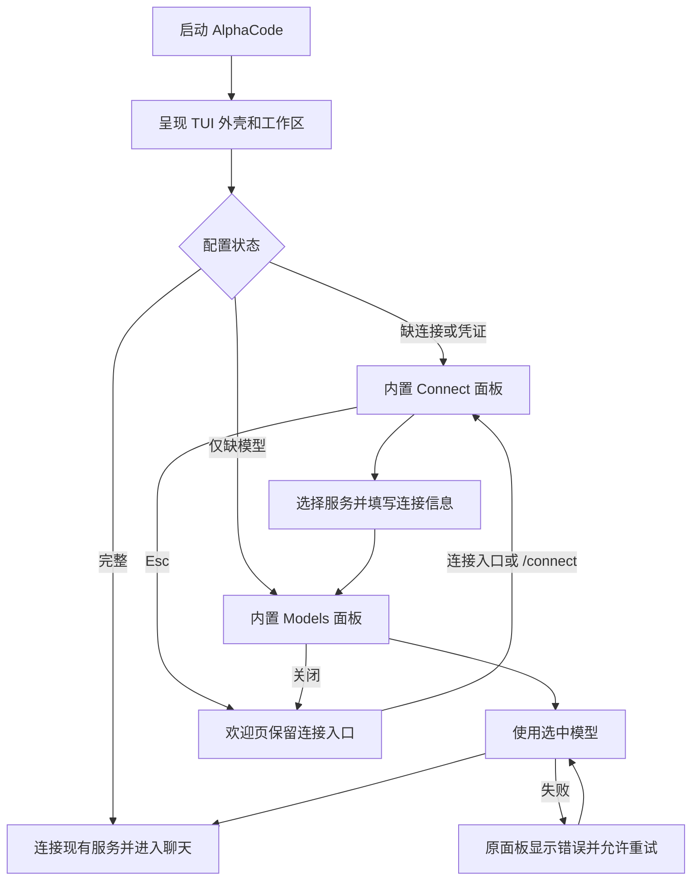

# AlphaCode TUI 内模型连接与首次使用方案

日期：2026-11-10。状态：设计草案，待评审，不进入实现。

上一版启动前 readline 问答方案及其代码已撤回。本文重新定义交互，不延续 `--setup` 启动向导。用户原有模型配置已恢复。

## 1. 核心体验

**执行 `alphacode` 后先进入完整 TUI，模型连接是 TUI 内的一项功能。**

用户始终处于同一个应用界面：能看到 AlphaCode、工作区、输入区和状态栏。缺少模型时，在这个界面内配置；配置成功后关闭面板、聚焦输入框，直接开始聊天。

建议采用「欢迎页 + 内置连接面板 + 模型选择面板」：

- 首次没有配置：TUI 首帧呈现后，自动打开连接面板。
- 按 Esc 关闭面板：回到欢迎页，保留 `Connect a model` 入口，不退出程序。
- 后续重新连接：在输入框使用 `/connect` 打开同一个面板。
- 已连接但未选模型：直接打开模型面板；后续使用 `/models`。
- 配置齐全：直接进入正常聊天，不显示首次配置提示。

配置过程不产生聊天消息，不经过模型，不把表单输入写入聊天历史。界面文案沿用当前项目的英文约定。

## 2. 完整路径



连接面板第一次自动打开后，用户主动关闭，就不因重绘、窗口调整或焦点切换再次弹出。只有主动打开入口，或尝试发送消息时，才重新进入。

用户可以在未连接时先写消息。点击发送时保留草稿并打开配置面板；配置完成后草稿仍在，由用户再次发送，避免意外提交。

## 3. 界面草图

以下为布局与内容草图，使用现有 TUI 的白色背景、蓝色强调色、灰色辅助文字；不另起一套视觉主题。

### A. 未配置的欢迎页

```text
 ›_ AlphaCode    Code starts here.

    Connect a model to start coding.
    [ Connect a model ]


 ──────────────────────────────────────────────────────────
 > Ask anything, or type /connect
 ──────────────────────────────────────────────────────────
 No model connected                             ~/project
```

首次启动会在此页面上打开 B 面板。Esc 关闭后看到的仍是这张欢迎页。输入框可编辑草稿和输入本地命令，普通消息在连接完成前不能提交。

### B. 选择服务

```text
 ┌ Connect a model ───────────────────────────────────────┐
 │ Search providers…                                     │
 │                                                       │
 │ › OpenAI                                              │
 │   OpenAI-compatible API                               │
 │   Ollama                                              │
 │   LM Studio                                           │
 │                                                       │
 │ ↑↓ Select                       Enter Continue  Esc Close│
 └───────────────────────────────────────────────────────┘
```

服务列表是方向键选择和文字搜索，不要求输入编号。首版只列出现有 Chat Completions 适配器能够承载的连接类型。Ollama、LM Studio 是端点预设，具体模型是否满足工具调用能力仍由实际服务决定。

### C. 填写连接信息

```text
 ┌ Connect · OpenAI-compatible API ───────────────────────┐
 │                                                       │
 │ Base URL                                              │
 │ https://your-provider.example/v1                       │
 │                                                       │
 │ Authentication     API key                            │
 │ API key            ••••••••••••••••                   │
 │                                                       │
 │ [x] Remember this key on this device                   │
 │     Stored locally on this device.                    │
 │                                                       │
 │ Advanced options                                      │
 │                                                       │
 │ [ Back ]                                  [ Continue ]│
 └───────────────────────────────────────────────────────┘
```

表单在同一个面板内完成，Tab 在字段间移动；错误紧贴对应字段显示。普通用户直接粘贴 API key，不先回答环境变量名称、配置文件路径等问题。

按服务类型减少必填项：

| 服务 | 默认表单 | 高级选项 |
| --- | --- | --- |
| OpenAI | API key；已有凭证显示 `Using existing key` | Base URL、环境变量来源 |
| OpenAI-compatible API | Base URL、API key | 无认证、环境变量来源 |
| Ollama / LM Studio | 预填本地地址，可直接继续；默认无认证 | 更改地址、启用 API key |

已有凭证优先复用；显示 `Replace key` 操作，不把原密钥放回可见输入框。勾选记住密钥表示后续启动可复用，取消勾选仅用于这次应用运行。具体存储机制见第 8 节，尚未定稿。

### D. 选择模型

```text
 ┌ Choose a model ───────────────────────────────────────┐
 │ OpenAI-compatible API                                 │
 │ Search models…                                        │
 │                                                       │
 │ › <model returned by the provider>                     │
 │   <another available model>                           │
 │                                                       │
 │   Enter a model ID manually…                          │
 │                                                       │
 │ [x] Use as the default for new chats                   │
 │ [ Back ]                                 [ Use model ]│
 └───────────────────────────────────────────────────────┘
```

优先尝试读取选定端点的模型列表；列表加载期间始终保留手动输入入口。自定义服务没有模型列表接口、列表为空或超时，都能继续手动填写，不能卡住整个引导。

点击 `Use model` 后面板内显示 `Starting chat…`。成功后面板关闭、状态栏显示实际模型，焦点回到原输入框。失败则保留当前选择和可编辑字段，显示重试操作。

不再追加一轮逐项摘要和 y/n 问答。服务、端点、认证状态与默认模型选项已在面板中可见，最终按钮承担确认动作。

## 4. 交互规则

| 操作 | 行为 |
| --- | --- |
| ↑ / ↓ | 在供应商或模型列表中移动选择；输入字段内保留编辑行为 |
| 输入文字 | 当前搜索框获得焦点时过滤列表 |
| Tab / Shift+Tab | 在当前面板的可操作控件间循环 |
| Enter | 提交当前明确聚焦的操作；选择模型时应用选择 |
| Esc | 子页面退回上一页；顶层关闭面板，返回原页面 |
| Ctrl+C | 面板打开时先取消当前操作并关闭；回到主界面后沿用退出/取消任务规则 |
| Resize | 同一面板重新布局，字段、选择、草稿保持不变 |

面板打开时拥有键盘焦点，底层 composer 不接收按键。关闭后恢复打开前的焦点和草稿光标。密钥粘贴不进入命令历史、消息列表或 debug 日志。

宽终端建议面板宽度约 64–72 列；窄终端使用可用宽度并减少辅助描述。高度不足时仅面板内容滚动，标题、错误和底部动作应可访问。仍使用同一个 OpenTUI renderer，不切换到外部终端输入模式。

## 5. 首次配置、补配置和后续修改

| 场景 | 进入位置 | 结果 |
| --- | --- | --- |
| 完全没有模型配置 | 服务选择 | 连接后选择模型，进入首个聊天 |
| 已有端点和模型，只缺密钥 | 对应连接表单，直接聚焦密钥 | 复用端点和模型，无需从头选择 |
| 已有凭证，只缺模型 | 模型列表或手动输入 | 选定后进入聊天 |
| 已有可用配置 | 正常聊天 | 不自动打开配置面板 |
| 认证失败 | 当前聊天保留，提供 `Update connection` 操作 | 打开已有连接表单，修复后由用户决定重试消息 |
| 主动 `/connect` | 连接面板 | 修改连接或新增连接草稿 |
| 主动 `/models` | 当前连接的模型面板 | 首版按“用于新聊天”处理，见下文 |

现有 session 记录模型 ID，并且 server 持有该 session 的 runtime。首版建议不原地替换已有聊天的 runtime：有聊天历史时，按钮明确写成 `Start new chat with this model`，旧聊天保留。切换当前聊天模型是另一个需要单独设计的能力。

若已有任务运行或审批待处理，允许查看连接信息，但暂停应用新的连接或模型，提示先完成或停止当前任务。不会为修改配置自动取消任务。

## 6. 技术设计：先有应用界面，再按需建立聊天

当前依赖链是 `loadConfig → connectApplication → runTerminal(chat)`。这使“没有模型”变成“不能呈现界面”，也是需要调整的根本原因。

建议把界面外壳与 Chat 生命周期分开：

| 层次 | 责任 |
| --- | --- |
| 应用外壳 | 工作区、欢迎页、composer 草稿、对话面板、全局快捷键；不以 Chat 已存在为前提 |
| 配置状态 | 区分读取中、缺连接、缺凭证、缺模型、可用、格式错误；只提供状态和可执行动作 |
| 连接/模型面板 | 表单草稿、列表选择、局部错误、返回与取消；不直接读写配置文件 |
| 应用协调层 | 解析配置来源、读取模型列表、保存、连接 server；负责异步请求和重试 |
| 聊天视图 | 获得真实 Chat 后承接消息、工具、审批和会话状态 |

未配置时无需创建假的 Chat、假的 session ID 或临时数据库会话。TUI 外壳先显示；用户选择完成后才调用现有 server 的连接能力。失败留在外壳内，服务与 UI 的生命周期各自清晰。

关闭面板或切换服务时取消未完成的模型列表请求；每次请求关联当前连接草稿，忽略过期结果，避免旧端点的模型覆盖新选择。提交期间禁用重复提交，应用协调层保证只建立一次聊天连接。

这里仅确定边界和生命周期。状态类型、组件签名、文件拆分及 server API 改动在交互方案确认后再设计和实现。

## 7. 错误与连接验证

| 情况 | 界面反馈与出口 |
| --- | --- |
| URL / 必填项错误 | 对应字段下显示错误，保留填写内容 |
| 401 / 403 | 标注凭证或权限问题，提供修改密钥与重试 |
| 连接超时 / 服务未启动 | 显示端点不可达；可编辑地址、重试或手动继续配置 |
| `/models` 不支持 / 返回空列表 | 显示手动模型输入，不当作整个连接不可用 |
| 保存失败 | 停留面板并保留草稿；提供重试保存或明确选择仅本次使用 |
| 配置 YAML 损坏 | 在 TUI 显示配置问题与文件位置；不把损坏文件当成空配置覆盖 |
| server 启动失败 | TUI 显示 `Could not start chat` 与重试入口，避免终端直接退出 |
| 非 TTY | 维持清楚的文本错误，不启动 TUI 或交互输入 |

模型列表查询建议 5 秒超时，可取消，不发送聊天内容、不请求生成。列表读取成功只表示列表接口可用，不宣称所选模型一定支持工具或所有生成参数。

首版不自动发起可能计费的模型生成请求。模型选定后显示已配置；首条用户消息的真实请求出错时仍能回到连接面板修复。若要增加“测试模型”，应作为清楚标明会发请求的独立操作另行设计。

## 8. 配置来源与保存策略

界面应展示对用户有意义的信息，例如 `Using key from environment`，不要求每个人理解 YAML 结构。普通配置与密钥分开；配置路径、环境变量名和存储详情放在高级选项。

启动默认仍沿用环境变量优先规则。若某个值由环境变量控制，标明来源；不能让用户修改后显示成功、实际仍使用旧值。

建议允许用户显式选择“仅此聊天使用另一连接”，作为运行内覆盖，不改写 shell 环境。保存为下次启动默认时，若环境变量仍覆盖它，应显示清楚的限制并取消默认勾选。此项涉及配置语义变化，需要在实现前与表单一起评审。

普通设置建议在最终 `Use model` 时提交，面板中的未确认内容一直是草稿。`Remember this key` 与“作为新聊天默认模型”分别控制凭证保存和模型默认值，不绑定成一个选项。取消未提交的草稿不改变原连接。

**密钥存储尚未定稿。** 可评估系统凭证库和用户目录独立文件的跨平台成本；若选本地明文文件，界面必须说明实际存储方式。不会把被撤回的 `credentials.json` 实现直接作为默认结论。无论使用哪种方式，密钥都不进入 session、项目索引、URL 或日志。

## 9. 首版范围与评审点

首版聚焦：未配置也能进入 TUI、内部连接面板、内部模型选择、部分配置补全、取消返回、失败可恢复，以及配置成功后原地开始聊天。

本轮不制作可运行原型、不增加组件、不修改配置格式。当前代码操作仅用于撤回旧实现并恢复原配置。

评审优先确认这三个产品决策：

1. 首次进入 TUI 后自动打开连接面板，Esc 可关闭并留在欢迎页。
2. 服务选择 → 连接表单 → 模型选择，全部发生在同一个 TUI；普通用户不填写环境变量名。
3. 最终选择成功后回到原输入框，保留草稿；后续 `/connect`、`/models` 复用同一套面板。

通过后再细化凭证持久化、环境覆盖和已有会话切换的实现约束。OAuth、新增原生模型协议、大型供应商目录及运行中切换模型不纳入这次首次配置工作。

## 10. 后续验收标准（尚未实现）

- 没有模型时首先看到完整 TUI，不出现启动前的逐行问答。
- 引导期间外壳、工作区与状态栏始终存在，终端不发生 renderer 重启。
- Esc / Ctrl+C 能回到欢迎页；再次 `/connect` 可以继续；不会循环弹出。
- 配置齐全的用户直接进入聊天，已有配置来源被正确复用。
- 不支持模型列表的兼容端点仍可以手动配置。
- 配置完成后焦点回到原 composer；草稿完整且不会自动发送。
- 错误在面板内可修复，重复提交和过期请求不会创建多份会话或串用凭证。
- 小窗口、长列表、粘贴密钥、关闭面板和调整终端尺寸均有明确行为。

## 11. 开源参考与采用理由

调研核对日期：2026-11-10。以下区分来源事实与本方案判断，不把竞品全部行为等同于 AlphaCode 需求。

| 项目 | 来源事实 | 本方案采用的方向 |
| --- | --- | --- |
| OpenCode | 官方 TUI 文档说明运行命令后进入终端界面；`/connect` 与 `/models` 是界面内命令。Providers 文档描述连接供应商后选择模型。 | 主参考：连接与选模型是应用内功能，首次与后续复用入口。自动弹出时机是本方案建议，并非据此断言 OpenCode 的首次行为。 |
| Gemini CLI | `AuthDialog.tsx` 使用 Ink 组件、单选列表和独立认证状态；已有设置、环境变量影响默认选项，错误作为界面状态呈现。 | 借鉴应用内认证面板、复用已有来源和局部错误反馈。具体 Google 登录能力不在本次范围。 |
| Aider | 上轮查阅的 `onboarding.py` 根据现有密钥帮助选择模型，并提供认证入口。 | 借鉴减少重复配置；其问答式 onboarding 不作为本次 TUI 交互模板。 |

来源：

- [OpenCode TUI 官方文档](https://docs.opencode.ai/docs/tui/)
- [OpenCode Providers 官方文档](https://opencode.ai/docs/providers/)
- [Gemini CLI AuthDialog 源码](https://github.com/google-gemini/gemini-cli/blob/main/packages/cli/src/ui/auth/AuthDialog.tsx)
- [Aider onboarding 源码](https://github.com/Aider-AI/aider/blob/main/aider/onboarding.py)
