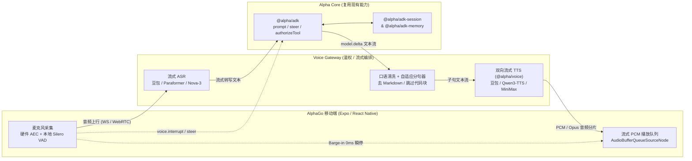
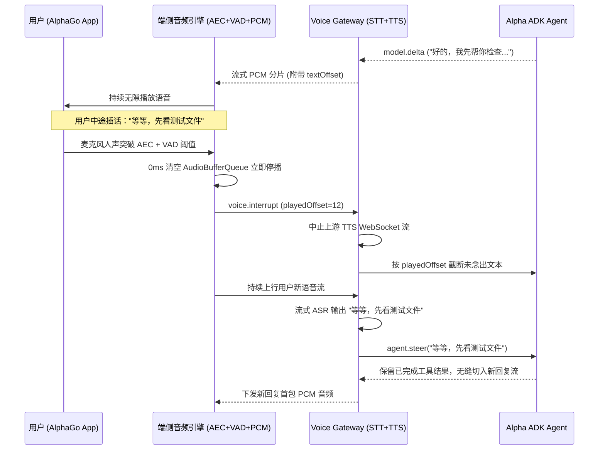

# AlphaGo 移动端语音助手技术方案调研

> 面向 **Alpha Monorepo** 生态的移动端语音助手 **AlphaGo** 技术选型与架构调研报告（2026-11）。
> 聚焦 **Phase 1：TTS 语音合成闭环**，并前瞻规划 **Phase 2–3：结合 `@alpha/adk`、会话与长期记忆的低延迟全双工语音对话移动端 App**。

## 核心结论速览

结合 Alpha 仓库已有架构（`@alpha/adk` 原生支持 `model.delta` 流式输出与 `agent.steer()` 运行中打断、全仓 TypeScript / React 19、已有 SQLite 会话与长期记忆）以及中文/中英混读优先的体验目标，推荐路线如下：

- **总体语音架构**：采用 **级联流式管道（Cascaded Streaming Pipeline：VAD → 流式 ASR → `@alpha/adk` → 动态分句 → 双向流式 TTS）** 作为主线，100% 复用现有 Agent 工具、权限审批、会话、记忆与多模型能力；中远期按需演进为「S2S 前台 + ADK 后台」混合双脑。
- **第一阶段 TTS 选型**：
  - 在仓库新建厂商无关的 **`@alpha/voice`** 抽象包（统一 `TtsModel` 契约 + Markdown 口语清洗器 + 自适应流式分句器）。
  - 云端首选 **阿里云 DashScope `Qwen3-TTS-Flash` / `CosyVoice v3`**（首包 ~100–220ms，性价比最高）或 **火山引擎豆包 `Seed-TTS 2.0`**（中文口语与中英混读自然度天花板），均支持 WebSocket 双向流式。
  - 端侧离线兜底预留 **Sherpa-ONNX + Kokoro-82M / Piper**（隐私/弱网降级）。
- **移动端 App 框架**：首选 **React Native + Expo（Development Build / New Architecture）**，放在 `apps/alphago` 复用全仓 TypeScript 协议契约；音频底层使用 Software Mansion 的 **`react-native-audio-api`**（`AudioBufferQueueSourceNode` 实现 24kHz PCM 零缝隙流式起播与 0ms 停播）。
- **传输协议演进**：Phase 1–2（TTS + 按住说话 PTT）使用 **WSS / HTTP Streaming** 极简上线；Phase 3（免提全双工通话）升级 **LiveKit（WebRTC）**，直接获得硬件级 AEC 回声消除与移动弱网 UDP 抗丢包能力。

---

## 一、Alpha 现有资产盘点与集成边界

| 现有模块 | 关键能力 | 对 AlphaGo 的价值与工程约束 |
| :--- | :--- | :--- |
| `packages/adk` (`@alpha/adk`) | 微内核 Agent Loop、`model.delta` 文本流、`agent.abort()`、**`agent.steer(input)`**、工具授权钩子 (`authorizeTool`) | **核心优势**：`model.delta` 可直接接流式分句喂 TTS；`agent.steer()` 天然匹配语音对话的**用户插话打断（Barge-in）**语义（保留已完成工具结果、跳过未开始工具、续跑新意图）。 |
| `packages/provider` (`@alpha/provider`) | 统一 LLM 协议适配（Anthropic / OpenAI Completions / Responses / Codex），`ModelMetadata.input` 已预留 `audio` | 目前仅定义 `LanguageModel` 契约，尚无 TTS/STT 音频流契约；建议新建独立 `packages/voice`（`@alpha/voice`）保持单向依赖干净。 |
| `packages/adk-session` & `packages/adk-memory` | SQLite 会话持久化 + 跨会话 Markdown 长期记忆（双语 FTS5 检索 + Auto-Dream） | 手机端语音与桌面端 AlphaCode 共享统一记忆与会话历史，真正成为“随身同一个助手”。 |
| `apps/alphacode-app-server` | 本地 Bun HTTP/SSE 服务 + Multi-Bot 超级 Agent（`external_channel`、`routerSessionId`、Worker Pool） | **重要安全边界**：当前仅监听 `127.0.0.1` 随机端口，无用户登录鉴权与 CORS，明确**不可直接暴露局域网或公网**；移动端必须通过独立鉴权网关或私网隧道接入。 |
| `apps/cloud-agent-server` | 独立 Go（Gin + GORM + PG/SQLite + SSE）云端服务模板 | 若 AlphaGo 定位为公网多端产品，可作为云端账号、鉴权、计费与语音房间签发控制面。 |
| `apps/alphacode-web` | React 19 + Tailwind v4 + Vite 8 + TypeScript 协议类型 | 为选择 React Native / Expo 提供极高的工程与类型契约复用。 |

---

## 二、语音对话总体架构选型

### 2.1 三种语音 Agent 架构对比

| 维度 | 方案 A：级联流式管道（推荐主线） | 方案 B：原生端到端 S2S（OpenAI Realtime / Gemini Live / Qwen-Audio Realtime） | 方案 C：混合双脑（中远期演进） |
| :--- | :--- | :--- | :--- |
| **核心链路** | VAD → 流式 ASR → `@alpha/adk` → 分句 → 流式 TTS | 音频流直连多模态语音大模型（Audio-to-Audio） | S2S 负责极速闲聊前台，复杂任务通过工具异步委派 `@alpha/adk` |
| **端到端首音延迟 (TTFA)** | **700 – 1,300 ms**（流式并行优化后） | **300 – 550 ms**（行业最低） | 闲聊 ~400ms / 复杂任务 1.5s+（附过渡语） |
| **Alpha Agent 复用度** | **100% 原生复用**（工具审批、多模型切换、Session、Memory、Trace、`steer()`） | **低**：音频黑盒难嵌入 ADK Loop，模型强绑定，复杂工具稳定性较弱 | **高**：前台拟人度强，后台保留完整 ADK 工程能力 |
| **可控性与审计** | **极高**：全链路文本留痕，发声前可清洗 Markdown/过滤敏感内容 | **较低**：缺乏确定性发声前文本护栏 | 中高，但需维护双上下文同步，复杂度最高 |
| **成本模型** | 各环节独立选型、成本可控 | 音频 Token 单价较高（如音频输出 ~$14–20+/1M tokens） | 中等 |

### 2.2 级联流式核心架构图



### 2.3 端到端首音延迟（TTFA）预算拆解

自然对话的体感延迟红线在 **800 ms – 1,200 ms** 左右；如果等 LLM 整段生成完再合成 TTS，延迟会超过 3 秒，无法用于实时交互。采用全链路流式并行后，预算如下：

| 阶段 | 未优化（整段生成再合成） | 推荐生产配置（旗舰 LLM + 豆包/Qwen） | 极限优化（Flash 模型 + 就近节点） |
| :--- | :---: | :---: | :---: |
| VAD / 语义停顿检测 | 400 ms | 250 ms | 180 ms |
| 流式 ASR 尾帧确认 | 300 ms | 160 ms | 120 ms |
| LLM TTFT + 首个子句切分（8–12字） | 1,800 ms | 420 ms | 280 ms |
| 双向流式 TTS 首包（TTFB） | 450 ms | 200 ms | 120 ms |
| 传输 + 移动端 PCM 起播缓冲 | 150 ms | 80 ms | 60 ms |
| **合计首音延迟 (TTFA)** | **~3,100 ms** | **~1,110 ms** | **~760 ms** |

---

## 三、第一阶段核心：TTS 技术方案深度调研

第一阶段目标是将 **TTS 体验做到高自然度、低首包延迟、接口厂商解耦**。

### 3.1 主流云端流式 TTS 引擎横向对比（2026 基准）

| 厂商 / 引擎 | 推荐模型 & 协议 | 中文 & 中英混读表现 | 典型首包延迟 (TTFB) | 参考价格（每百万字符） | 核心优势与接入注意点 |
| :--- | :--- | :--- | :---: | :---: | :--- |
| **火山引擎 豆包**<br/>(ByteDance) | `Seed-TTS 2.0`<br/>WebSocket **双向流式**（二进制帧 V3） | **天花板级**：中文口语停顿、呼吸感与中英混读极自然 | ~200 – 400 ms | 刊例 ~¥500（约 ¥5/万字，资源包/活动更低） | **国内中文体验首选**；支持秒级声音复刻。注意 WS 鉴权头格式（旧版 `Authorization: Bearer;<token>` / 新版 `X-Api-Key` + `X-Api-Resource-Id`）与二进制帧编解码。 |
| **阿里云 DashScope**<br/>(Qwen / CosyVoice) | `Qwen3-TTS-Flash` / `CosyVoice v3`<br/>WebSocket **双向流式** | **极佳**：多方言、跨语种音色克隆、指令控制情绪/语速 | **~100 – 220 ms**<br/>(Flash 档极快) | Flash ~$15 (≈¥110)<br/>Plus ~$20–30 (≈¥150–220) | **延迟与性价比综合最强**；同时提供北京与新加坡节点，适合国内与海外兼顾。 |
| **MiniMax Audio** | `Speech 2.6 / 2.8 Turbo & HD`<br/>WebSocket 流式 | **顶级**：情感张力、粤语与长文本表现极强，数字/URL/日期归一化省心 | < 250 ms<br/>(Turbo 档) | Turbo ~$60 (≈¥435)<br/>HD ~$100 (≈¥720) | 播客/情感陪伴体验极佳，但规模化使用单价偏高。 |
| **Cartesia** | `Sonic 2 / 3` (SSM 架构)<br/>WebSocket 双向流式 | 英文顶级；中文可用但偶有译制腔 | **~40 – 150 ms**<br/>(全球最快) | ~$49 (≈¥355) | 英文/出海实时语音 Agent 速度标杆。 |
| **ElevenLabs** | `Flash v2.5` / `Eleven v3`<br/>WebSocket 流式 | 英文表现力与音色克隆第一；中文持续进步但非本土最优 | ~75 – 150 ms<br/>(Flash) | ~$30 – $40+ | 适合强情感角色演绎与高精度克隆，中文性价比不如豆包/阿里。 |
| **OpenAI TTS** | `gpt-4o-mini-tts` / `tts-1`<br/>HTTP Chunked 流 | 中英标准清晰，口语微表情略逊 | ~250 – 450 ms | ~$15 (≈¥110) | 接入最简单，但缺少标准文本双向流式输入。 |

> 注：以上单价为公开渠道参考值，实际接入前请以各厂商控制台最新计费规则及资源包折扣为准。

### 3.2 端侧离线 TTS 与自托管开源方案

- **端侧离线（移动端本地推理）**：
  - **Sherpa-ONNX + Kokoro-82M**（~82M 参数，StyleTTS2 + ISTFTNet 架构）：2025–2026 移动端离线 TTS 事实标准，支持中英文多语种，借助 Sherpa-ONNX 或 `react-native-executorch` 可在中高端手机近实时合成，音质接近云端。
  - **Sherpa-ONNX + Piper / VITS / Matcha-TTS**：模型体积仅 35–80 MB，极速低功耗，适合弱网/断网降级与短提示音。
  - **系统原生引擎（iOS `AVSpeechSynthesizer` / Android `TextToSpeech`）**：零包体积、零成本，但机械感明显，仅建议用于无网保底；其中 Android 支持将自研 Sherpa-ONNX 注册为**系统级 TTS 引擎**。
- **自托管开源 GPU**：
  - **CosyVoice v2 / v3**（Apache 2.0）：原生支持双向流式与零样本跨语种克隆，单卡 GPU 首包 ~150ms。建议在日活和字符量上升到需要压降 API 成本、或有私有化要求时再投入 GPU 运维，MVP 阶段优先云 API。

### 3.3 面向 Agent 的三大 TTS 工程化关键细节

1. **口语文本清洗器（Speech Sanitizer）**：
   - Alpha Agent 回复常包含 Markdown 标题、代码块、表格、`file:///` 路径、JSON 工具结果与 Emoji。直接合成会念出大量无意义符号。
   - 必须引入流式清洗管线：剥离 Markdown 标记、将代码块折叠为简短口语提示（如“代码已在屏幕上展示”）、压缩长 URL 为域名、保留自然标点停顿。
2. **双阶段自适应分句器（Adaptive Clause Chunker）**：
   - 订阅 `@alpha/adk` 的 `model.delta`：
     - **首句激进模式**：累计 ≥ 8 字且遇到 `，、。！？；：\n` 立即吐出第一段给 TTS，最大化压低首音延迟。
     - **后续稳态模式**：按完整句末标点合并 20–60 字窗口再下发，避免切分过碎导致语调断层。
   - 若上游 TTS 支持原生双向流式（豆包 / Qwen3-TTS / Cartesia），清洗后的 token 流可直接持续推入同一 WebSocket 会话，由模型内部控制韵律连贯性。
3. **在 Alpha 仓库抽象统一的 `@alpha/voice` 契约**：

```ts
// packages/voice/src/contracts.ts (设计草案)
export type AudioEncoding = 'pcm_s16le' | 'opus' | 'mp3';

export interface AudioChunk {
  readonly data: Uint8Array;
  readonly encoding: AudioEncoding;
  readonly sampleRate: 16000 | 24000 | 48000;
  readonly channels: 1;
  readonly seq: number;
  /** 可选：该音频片对应原文字符偏移，用于 Barge-in 精确截断上下文 */
  readonly textOffset?: number;
}

export interface TtsSessionOptions {
  readonly voiceId: string;
  readonly speed?: number;       // 0.5 ~ 2.0
  readonly encoding?: AudioEncoding;
  readonly sampleRate?: 16000 | 24000;
  readonly signal?: AbortSignal; // 用户打断时立即中止上游合成
}

export interface TtsModel {
  readonly provider: string;
  readonly modelId: string;
  /** 单段文本流式合成（适合长文朗读 / 通知 / 预缓存） */
  synthesize(text: string, options: TtsSessionOptions): AsyncIterable<AudioChunk>;
  /** 双向流式：直接对接 @alpha/adk 的 model.delta 文本流 */
  stream(textStream: AsyncIterable<string>, options: TtsSessionOptions): AsyncIterable<AudioChunk>;
}
```

---

## 四、移动端 App 技术栈选型

| 选型方案 | 音频底层能力（PCM / AEC / WebRTC） | 与 Alpha 仓库复用度 | 工程效率 | 核心风险与注意项 |
| :--- | :--- | :--- | :--- | :--- |
| **React Native + Expo**<br/>(Dev Build / New Arch)<br/>**★ 推荐** | **成熟**：`react-native-audio-api`（C++ CoreAudio/Oboe，提供 `AudioBufferQueueSourceNode` 原生播 PCM）+ LiveKit 官方 RN SDK | **极高**：全仓统一 TypeScript + React 19，可直接放在 `apps/alphago` 共享协议类型与工具链 | 高（EAS Build 自动化、AI 协作效率高） | 不可用 Expo Go，必须使用 **Expo Prebuild / Development Build**；高频 PCM 切片需避免阻塞 JS 线程。 |
| **Flutter**（Dart） | **极佳**：Dart Isolate 处理音频缓冲优雅，LiveKit Flutter SDK 与 `sherpa_onnx` 成熟，Impeller 声波动画丝滑 | **低**：独立 Dart 工具链，需双端维护协议契约 | 中高 | 引入第二套前端语言生态，长期维护切换成本高。 |
| **双端原生**<br/>(SwiftUI + Kotlin) | **天花板**：iOS CallKit / Live Activities / Siri Intents、Android 系统级 TTS Engine 与前台服务零损耗 | **最低**：双倍开发量 | 低 | MVP 验证周期过长；建议仅在核心瓶颈处用 RN Native Module 局部原生化。 |
| **Web / PWA / Capacitor** | **弱**：受制于 Safari/WebView 音频策略，无法细粒度控制 `AVAudioSession`，锁屏后台极易断流，外放 AEC 差 | **最高**：直接复用 `alphacode-web` | 最快 | **不适合作为主力手机语音助手**，仅适合作为开发阶段的桌面 Web 联调页。 |

> **关键避坑（流式 TTS 播放）**：切勿用 `expo-av` 或 `react-native-track-player` 把每个音频分片落盘成临时 MP3 再逐段播放——会产生明显“咔嗒”断音与 200ms+ 磁盘延迟。Phase 1 就直接使用 **`react-native-audio-api` + `AudioBufferQueueSourceNode`** 消费 24kHz 16-bit Raw PCM，同时配置 `AVAudioSession`（iOS `playAndRecord` + `voiceChat` / `defaultToSpeaker` / `allowBluetooth`）与 Android AudioFocus，一步到位解决无隙播报、0ms 打断停播与后台锁屏续播。

---

## 五、第二阶段深度规划：全双工语音对话、打断与后端拓扑

### 5.1 流式 ASR 选型（中文 & 中英代码混读）

| ASR 方案 | 中英混读质量 | 典型流式延迟 | 部署形态 | 适用场景 |
| :--- | :--- | :---: | :--- | :--- |
| **火山引擎 豆包流式 ASR (Seed-ASR)** | **极佳**（中文口语与英文术语混读自然） | ~150 – 250 ms | 云端 API | 与豆包 TTS 同厂商一站式对接，国内网络稳定 |
| **阿里云 Fun-ASR / Paraformer-v2** | **高**（支持热词与领域词表增强） | ~150 – 300 ms | 云端 API / 开源自托管 | 需热词定制（项目名、代码符号）或后续私有化部署 |
| **Deepgram Nova-3 (`language=multi`)** | **极佳**（端到端句内中英切换） | **~200 – 250 ms** | 云端 API | 海外节点或强英语/代码术语混合场景 |
| **端侧 Sherpa-ONNX (SenseVoice / Paraformer)** | 中上 | 本地实时 | 手机端侧离线 | 弱网离线兜底、本地关键词唤醒 |

### 5.2 传输协议演进：WebSocket → WebRTC (LiveKit)

- **Phase 1–2（流式 TTS + 按住说话 PTT 半双工）**：采用 **WSS（WebSocket）或 HTTP/2 Streaming**。工程极简、无需部署 STUN/TURN、易排错、延迟在 Wi-Fi / 稳定 5G 下完全够用。
- **Phase 3（免提全双工通话）**：引入开源 **LiveKit Server（WebRTC）**。移动蜂窝网抖动时 TCP WebSocket 会触发队头阻塞卡顿，而 WebRTC 基于 UDP + Opus 自适应码率 + 抖动缓冲，且自带硬件芯片级 **AEC / NS / AGC**，是防自激回声与自然打断的行业标准底座。

### 5.3 Barge-in（用户打断）与 `@alpha/adk` 精确联动



> **上下文对齐（Played-Text Truncation）**：LLM 生成速度远高于人耳收听语速（1 秒可能已吐出 40 字，手机实际只念完前 10 字）。打断时必须结合端侧回报的已播放偏移量截断上下文，防止 Agent 误以为后半段已告知用户。

### 5.4 后端部署拓扑：安全连接现有 Alpha Agent

由于 `apps/alphacode-app-server` 仅信任本机 `127.0.0.1`，移动端接入推荐按阶段选择：

1. **模式 A：个人随身助手（私网直连本机 Alpha，推荐 MVP 起步）**
   - 新增独立 `apps/alphago-voice-gateway`（Bun）：负责 Bearer Token 鉴权、托管 TTS/ASR 密钥、编排音频流，并在本机直连 `@alpha/adk` / `alphacode-app-server`。
   - 手机通过 **Tailscale / WireGuard** 私有虚拟局域网连接网关，**零公网端口暴露**，且手机语音能直接指挥电脑上的 AlphaCode、本地工作区与 Multi-Bot。
2. **模式 B：云端多端产品化（对接 `apps/cloud-agent-server` 或云端 Bun Voice Server）**
   - 独立云端认证（JWT/OAuth）、PostgreSQL 会话与用户隔离、云端托管 TTS/ASR 密钥与 LiveKit Token 签发；若需操控桌面工作区，再通过加密反向隧道桥接桌面节点。

---

## 六、分阶段实施路线图

1. **Phase 0 · `@alpha/voice` 核心包与 TTS 听感/延迟基准（3–5 天）**
   - 新建 `packages/voice`：落地 `TtsModel` 契约、Markdown 口语清洗器、自适应流式分句器、离线测试夹具。
   - 接入首个云端双向流式 Adapter（**阿里云 Qwen3-TTS-Flash** 或 **豆包 Seed-TTS 2.0**），做 10 组真实中英混读/代码对话盲测与 P50/P95 首包延迟实测。
2. **Phase 1 · AlphaGo 移动端原型与流式 TTS 闭环（1–2 周）**
   - 在 `apps/alphago` 初始化 **Expo（React Native Dev Build）**，集成 `react-native-audio-api`。
   - 跑通：**文本输入 / 历史消息朗读 → 网关流式 TTS → 移动端 24kHz PCM 边下边播 + 0ms 打断停播 + 音色/倍速切换 + 声波动画 + 息屏后台播放**。
3. **Phase 2 · 接入 `@alpha/adk` 实现半双工语音对话（2 周）**
   - 构建 `apps/alphago-voice-gateway`，接入 `@alpha/adk`、`@alpha/adk-session`、`@alpha/adk-memory` 与流式 ASR。
   - 跑通：**按住说话（PTT）→ 实时转写 → Agent 思考与工具执行（带“正在帮你查…”语音反馈 + 移动端工具审批弹窗）→ `model.delta` 边生成边播报**。
4. **Phase 3 · 升级全双工免提通话与端侧离线增强（2–3 周）**
   - 引入 **LiveKit（WebRTC）** 获得硬件 AEC/NS 与弱网抗丢包；
   - 落地 **随时打断（Barge-in → `agent.steer()` + 已播偏移截断）** 与语义停顿检测；
   - 按需集成端侧 **Sherpa-ONNX（Silero VAD + Kokoro-82M）** 做弱网离线兜底。

---

## 七、进入开发前待确认的 4 个决策

1. **产品形态与部署模式**：先做个人随身助手（Tailscale 私网直连本机 Alpha），还是直接面向云端多用户产品化？
2. **Phase 1 首接 TTS 引擎**：**阿里云 Qwen3-TTS-Flash / CosyVoice**（性价比 + 低延迟）、**火山引擎豆包 Seed-TTS 2.0**（中文口语上限）、**MiniMax Speech Turbo**（强情感），还是先走**端侧离线 Sherpa-ONNX + Kokoro-82M**？
3. **移动端技术栈**：确认 **React Native + Expo Dev Build**（与 Alpha TS 生态最契合），还是偏好 Flutter / 单端原生？
4. **首台真机验证平台**：优先 **iOS** 还是 **Android**（Android 额外支持系统级 TTS 引擎能力）？
