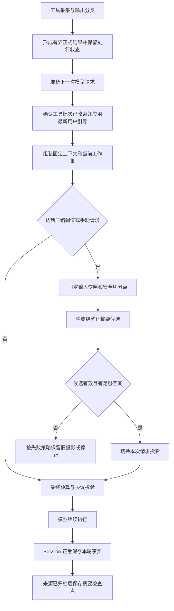

# Alpha 上下文管理第一版设计

状态：第一版实现已落地；真实模型的摘要质量与成本评测待补充

日期：2026-11-13

范围：Alpha ADK、Session 与 AlphaCode 的单会话上下文管理，包含同一会话重启后的恢复。本文保留设计依据，以下实施记录说明当前代码行为。

## 2026-11-14：Artifact 与显式上下文引用

在第一版基础上增加 `@alpha/adk-artifact`，提供会话隔离的不可变 UTF-8 文本存储、Memory / SQLite 实现和带 SHA-256 的 `context://` 引用。AlphaCode 默认保存命令 stdout / stderr，保留有限预览；通过 `read_context` 分页读取 Artifact 或摘要引用的原始消息。消息引用携带来源 ID、会话范围及完整消息内容校验值，不改写 Session 归档。

摘要输入现在为带显式引用的来源消息，要求保留重要约束与证据引用，并拒绝生成输入中不存在的标准引用。运行时负责将 reader 绑定正式历史；压缩、重启和重复请求均不重放工具。会话删除同时清理 Artifact，并通过墓碑阻止旧连接再次写入。

采集和读取有明确上限：每个命令通道 8 MiB，单会话 128 MiB / 10,000 个产物，单次回读最多 4096 字节。`complete=false` 表示采集本身不完整，不能与分页的 `hasMore` 混淆。保存失败只影响证据可回读性，不修改退出码和执行事实。存储在命令结束时提交，不承诺宿主中途崩溃后的未提交日志恢复。下面原第一版“不提供完整日志或消息回读”的描述属于历史范围，以本节及 [Artifact API](../packages/adk-artifact/README.md)、[Context API](../packages/adk-context/README.md) 为准。

## 第一版实施记录

- `packages/adk-context` 提供可选的上下文管理插件、结构化摘要策略和 SQLite 检查点存储；core 增加单一 `provideModelContext` 最终投影扩展，不接管 Session 的运行边界。
- AlphaCode 默认启用自动压缩。每次模型调用前计算 `B = C - O - max(4096, 0.05 × C)`，达到 `0.8B` 时整理旧历史，尽量降至 `0.55B`；默认 O 为 8192，实际作为 `maxOutputTokens` 发出。窗口未知时只显示估算用量，须配置实际路由窗口才能压缩。
- 第一版使用 UTF-8 序列化大小估算 token，并依据模型报告的输入用量向上校准。界面标记为估算值；没有声称使用精确 tokenizer。配置窗口和模型元数据同时存在时取较小值。
- 摘要使用当前模型、空工具列表和独立的 60 秒超时。每次准备最多 8 次辅助请求，格式或长度不合格的摘要最多重试一次；这些请求计入当前 run 的模型调用预算和汇总用量。手动整理没有新增 run，使用独立计数。大归档按完整消息组分块处理，超出本次预算则保留旧状态并报告失败。
- 摘要 JSON 字段为 `objective / constraints / decisions / completed / inProgress / failures / validation / nextSteps / evidence`。摘要作为普通 assistant 内容注入；当前 run 的用户输入与追加指令、固定注入内容、最近工具批次仍保留原文。最近历史额度是软目标，无法满足硬预算时停止请求。
- `/compact` 在会话空闲时立即整理，支持取消，不新增归档轮次、不执行工具。自动压缩关闭时，仍可手动整理；已有有效检查点仍可复用，但不进行自动超限重试压缩。
- 检查点保存在会话数据库旁的 `<databasePath>.context.db`，只在源消息已进入会话归档后保存。恢复校验模型、指令、工具指纹和覆盖前缀哈希；单纯追加消息不会使检查点失效。CAS 冲突只损失缓存，不改变会话执行结果。删除会话会清理对应摘要并阻止旧写入者重新写回。
- `read_file` 和 `readSkill` 返回完整选定内容，超过上限明确报错。搜索只删除完整条目；命令 stdout、stderr 分别有界保留首尾，不改变退出码和执行状态。未交付的文件读取不提供后续编辑依据。
- Web 用量面板显示系统/工具/摘要/消息拆分、输入预算、输出预留和压缩状态；CLI 增加 `/compact` 命令和压缩中的状态提示。
- 没有实现 Memory、跨会话检索、后台异步压缩或完整命令日志存档。确定性回归使用模拟模型；实际任务质量、摘要漂移和成本需要后续真实模型评测。

全局 `config.yaml` 可以配置：

```yaml
model:
  id: your-model-id
  contextWindow: 128000 # 填写当前端点的真实限制
  maxOutputTokens: 8192
context:
  autoCompact: true
```

配置在创建运行时读取；修改后重启会话运行时生效。`CONTEXT_LIMIT` 表示保留内容仍超过预算，`CONTEXT_COMPACTION_FAILED` 表示本次无法生成可用摘要，`CONTEXT_WINDOW_UNKNOWN` 表示缺少窗口配置，`CONTEXT_NOTHING_TO_COMPACT` 表示没有可整理的旧消息。

本地验证：255 项核心/Provider/工具/上下文及服务集成回归通过，Web 171 项测试通过；类型检查、lint 与中英文文案检查通过。全量高并发运行曾出现界面超时及 Windows 临时目录占用，降低界面测试并发并重跑对应测试后通过。打包后安装环境测试仍按仓库现有条件跳过。

第一版结合 Claude Code 的任务状态摘要与按需读取，以及 Alma 的工具输出分类与近期原文保留，采用 **工具输出控制 + 完整会话归档 + 结构化工作摘要 + 最近原始消息** 的组合方案。

处理分两步：工具产生结果时，按内容性质形成有界的正式结果；每次模型调用前，检查完整请求预算，必要时摘要旧历史。已经提交的历史和工具执行事实不因后续压缩而改写。摘要优先保留目标、用户约束、决策、未解决问题和下一步，让模型能从当前状态继续工作。

**Memory 明确不在第一版范围内。** 不做用户画像、自动长期记忆提取、向量库、跨会话检索或知识积累。工作摘要和压缩检查点只属于当前 session，用于该会话续写与恢复；新建会话不自动继承。后台压缩和供应商原生压缩也留到后续。

## 第一版设计选择

| 选择 | 建议 | 原因 |
| --- | --- | --- |
| 历史与上下文 | 分开管理，完整归档作为事实来源 | 压缩失败、摘要遗漏或模型切换后仍可重建 |
| 工具输出 | `exact` / `compact` / `passthrough` 分类，在正式结果提交前处理 | 保护精确数据，提前限制大段观测文本 |
| 基础策略 | 旧内容摘要，近期内容保留原文 | 同时保留长期目标和最近操作的精确细节 |
| 检查时机 | 每次模型调用前，而非只在用户发送消息时 | 一次 run 内的工具循环也可能耗尽窗口 |
| 首版压缩方式 | 同步执行，使用当前模型，无工具权限 | 先验证连续性和恢复语义，再优化延迟与费用 |
| 运行边界 | core 保留执行权，独立 Context 扩展提供策略 | 延续现有微内核和可选扩展方向 |
| 持久化 | 摘要作为可重建的派生检查点，与 Session 主归档分开保存 | 避免压缩与 Session 的 pending / CAS 提交互相干扰 |
| 首版边界 | 只管理当前 session，不建设 Memory | 会话续写与跨会话记忆有不同的数据边界 |

“结合 Claude 与 Alma，Memory 后置”作为本轮确定的范围。以下阈值、模块名称和新增扩展点是 Alpha 的设计建议，尚未成为公开 API 契约，也不代表两款产品的内部实现。

## 项目现状与可复用能力

以下以当前工作区源码为准；旧版 AlphaCode 文档中的固定轮次裁剪不等于当前实现。

| 位置 | 已有能力 | 对本方案的影响 |
| --- | --- | --- |
| [Session 契约](../packages/adk-session/src/contracts.ts) 与 [运行边界](../packages/adk-session/src/internal/session.ts) | 完整 turn 归档、请求去重、CAS 准入和提交、pending / blocked 状态；默认恢复全部 turn | 可以保留事实历史；压缩不能绕过归档健康检查 |
| `SessionManagerOptions.selectContext` | 按原顺序选择完整 runId | 可做轮次选择，不能插入摘要，也不能处理当前 run 内不断增长的消息 |
| [ADK 模型网关](../packages/adk/src/core/internal/model-gateway.ts) | 每次模型调用前执行 `beforeModel`，随后验证投影并组装系统指令和工具定义 | 已有请求投影入口，但 hook 看不到最终完整请求及其预算 |
| 同一模型网关与 [消息校验](../packages/adk/src/core/internal/messages.ts) | 工具结果和含工具调用、continuation 的 assistant 消息必须与原历史一致；工具批次必须完整；`custom` 不能直接发给模型 | 可以整体省略已完成批次，不能直接缩写某条已有工具结果，更不能伪造执行事实 |
| [Coding Agent 组装](../packages/coding-agent/src/create-coding-agent.ts) 与 [全局指令插件](../apps/alphacode-app-server/src/runtime/global-instructions.ts) | 项目指令、技能目录和全局指令经 `beforeModel` 注入，目前表现为 user 消息 | 压缩必须识别来源；不能把所有 user 消息都当作可压缩对话 |
| [上下文用量](../apps/alphacode-app-server/src/runtime/context-usage.ts) 与 [运行时组装](../apps/alphacode-app-server/src/runtime/create-runtime.ts) | 估算出站消息、系统指令和工具定义；目前采用序列化后的 UTF-8 字节数除以 4；App Server 将历史消息数和字节上限设为不限 | 可以复用用量展示；估算器需要升级，已有展示不构成自动压缩或可靠的防溢出机制 |
| [Coding 输出编码](../packages/coding-agent/src/internal.ts) 与 [命令输出采集](../packages/coding-agent/src/process/run-command.ts) | 编码器会缩短较大的 `content`、`stdout`、`stderr` 等字段；命令采集目前在容量内保留输出前部 | 需要增加精确性分类，避免统一缩短源码；保留命令尾部需要调整采集阶段，不能只改最终编码 |
| [Provider 类型](../packages/provider/src/types.ts) 与 [错误类型](../packages/provider/src/errors.ts) | 多协议适配、模型窗口元数据、输出上限字段及部分 continuation；尚无统一压缩能力或专用上下文超限错误 | 首版使用供应商无关的文本摘要；原生压缩需要单独适配 |

两个必须保留的现有约束：

1. Session 结束时验证恢复基线未变，再保存本轮新增消息。运行中替换正式 history 会破坏这条约束，因此历史摘要只作用于模型请求投影；工具输出控制发生在该结果首次提交之前。
2. `provideRunBoundary` 至多一个贡献者，已经由 Session 使用。Context 扩展不能再注册第二个运行边界。

“完整归档”指 ADK 已经正式提交的消息。工具执行器自身的输出截断、超限占位等现有行为，意味着归档不一定包含外部进程产生的全部原始字节。若后续提供完整日志回读，需要先建设对应的产物存储。

## Claude 与 Alma 的组合取舍

| 来源 | 公开机制 | Alpha 第一版的选择 |
| --- | --- | --- |
| Claude Code 的任务摘要 | 保留架构决策、未解决问题和实现细节，强调先保证关键内容召回，再减少冗余 | 摘要描述可继续执行的工作状态；质量优先于压缩比例。[Anthropic 官方文章](https://www.anthropic.com/engineering/effective-context-engineering-for-ai-agents) |
| Claude Code 的按需读取 | 固定项目指令与文件搜索、读取配合使用，避免把所有材料长期放进窗口 | 保留路径、版本和必要证据；源码需要时重新读取，不把整仓库装入摘要。[Anthropic 官方文章](https://www.anthropic.com/engineering/effective-context-engineering-for-ai-agents) |
| Alma 的对话压缩 | 按使用比例触发，保留最近消息原文；文档公开可配置比例 5% 至 95%、保留 2 至 20 条 | 采用比例触发与近期保留，但以完整请求 token 预算和工具批次切分为准，不照搬条数或未知默认值。[Chat Settings](https://alma.now/docs/settings/chat) |
| Alma 的工具输出分类 | `exact` 保持精确，`compact` 允许缩短文本，`passthrough` 跳过文本压缩；未知插件工具默认 `exact` | 第一版将分类落实到自带工具的结果生成阶段；不对每条工具结果调用摘要模型。[Plugin API](https://alma.now/docs/plugins/api-reference#tool-result-safety) |

组合后的行为是：精确材料按范围读取，观测文本在进入历史前控制大小；最近工作保留正式原文，旧工作归纳为任务状态；在需要细节时重新读取可获取的证据。旧工具批次整体进入摘要，不随意清空其中某条结果。

这解决了四类问题：单靠大窗口仍会累积噪声；单靠消息条数无法约束大输出；只做摘要容易损失近期精确细节；不区分输出性质会破坏后续编辑所需的源码或标识符。

来源边界：这里采用 Anthropic 的公开工程原则和 yetone Alma 的官方产品契约。摘要模板、预算、检查点、取消和恢复协议由 Alpha 自行设计，不将未取得的产品内部算法视为事实。

此前对照的 LangChain、OpenCode 和原生压缩方案作为调研背景，不增加第一版依赖。榜单比较的是整个 Agent 系统，第一版仍需用我们的工具结果和长会话回放验证具体收益。

## 上下文应分成哪些部分

### 完整历史与模型工作集

Session 保留完整正式历史，用于界面展示、审计、去重和恢复。模型工作集是从历史及当前环境生成的投影，两者具有不同生命周期。

| 层 | 内容 | 处理原则 |
| --- | --- | --- |
| 固定上下文 | 系统指令、当前项目与全局指令、技能目录、工具定义 | 每次请求保留，不交给摘要模型重写；计入预算 |
| 工作摘要 | 当前目标、持续约束、关键决策、进度、阻塞和下一步 | 有大小上限、覆盖范围、版本与来源引用 |
| 近期原文 | 最近对话、最近工具调用及已正式提交的结果 | 按 token 预算保留，保持顺序和完整批次；不再二次截短已提交结果 |
| 当前任务锚点 | 最新用户输入、尚未落实的 steering、更近的纠正 | 保留原文；不能因进入长工具循环而被裁掉 |
| 按需证据 | 可读取的工作区文件、用户已提供的材料及现有产物 | 直接按路径和范围读取；不引入 Memory 检索，已变更的文件必须重新验证 |

概念上的请求内容为：固定上下文 + 工作摘要 + 近期原文及当前任务锚点。工具定义仍走 Provider 的 tools 字段；该分层不是要求把它们全部串成一条文本消息。近期原文与锚点有重叠时，只发送一次，并保持原始顺序。

固定指令、技能目录和工具定义保持稳定顺序；摘要在未触发下一次压缩前保持不变。临时耗时、token 用量和 UI 状态不加入提示词，避免不必要地改动请求前缀。

压缩后的摘要属于历史材料的派生描述，不提升为 system / developer 指令。摘要中的文件内容、命令输出及外部文本继续被视为数据；用户的新纠正优先于旧摘要。

### 原子分组与保留规则

切分单位不能只是数组中的单条消息：

- 含多个 tool call 的 assistant 与该批全部 tool result 作为一组，整组保留或整组纳入摘要。
- 有 continuation 的消息依照 Provider 协议作为不可拆分内容处理；近期继续使用时保持原样，不能只留下半段协议状态。
- 当前最新完成的工具批次保留正式提交的原文，确保下一次模型能直接消费结果。更早且已被后续模型消费的批次可以压缩。
- `outcome_unknown`、会话 pending 或 blocked 必须按现有执行与恢复规则处理，不能通过省略消息恢复运行。
- 对话历史之外注入的内容默认固定保留。来源识别依赖消息身份和明确标记，不依赖对文本前缀的猜测。

在多个历史 turn 之间切分最简单；单个 run 很长时，也允许在已完成的工具批次之间切分。始终保留当前任务锚点和最近工作尾部，不要求把整个当前 run 原文留下。

## 工具输出控制

### 处理位置与规则

第一版在自带工具的输出采集和结果编码阶段落实分类，然后将形成的结果交给 core 正常提交。Context 扩展只读取正式结果，不在 `beforeModel` 中重写它。这样可以提前降低输出体积，同时保留现有工具消息不可改写的保证。

| 模式 | 结果生成规则 | 超限处理 |
| --- | --- | --- |
| `exact` | 请求范围内的源码、标识符、状态及结构化值原样返回 | 读取时采用明确范围；仍放不下则返回容量错误，不自动改写内容 |
| `compact` | 只缩减工具显式允许的观测文本字段或结果列表 | 使用有界的头尾截取或条目上限，显式标记不完整；不调用 LLM |
| `passthrough` | 不运行文本压缩器 | 仍受字节、协议和上下文限制；不支持的模态直接拒绝 |

分类默认 `exact`。`compact` 需要工具作者或宿主明确指定可缩减字段，不能通过模型生成的描述临时放开。状态码、退出码、文件路径、revision、调用 ID、计数及完整性标志始终按精确字段处理；一个工具可同时包含精确元数据和允许缩减的日志正文。

`exact` 约束的是结果内容的产生与保留方式，不意味着该结果必须永远驻留上下文。旧批次仍可整体纳入历史摘要；一旦要依赖其源码做精确编辑，应重新读取文件，不能拿摘要中的改写充当原文。

### 自带工具的第一版策略

| 工具 | 输出策略 | 必须保留 |
| --- | --- | --- |
| `read_file` | `exact`；使用已有行范围读取，不再被通用编码器自动缩短 `content` | 请求范围内的完整内容、路径、revision、实际范围及是否为文件片段 |
| `readSkill` | `exact`；完整返回或明确容量错误 | 技能正文与来源，不摘要规则文本 |
| `create_file`、`edit_file` | `exact`；返回短结果凭据 | 实际操作结果、路径、revision；输出处理不能改变成功或失败事实 |
| `list_files`、`search` | `compact`；限制条目数量，每条已返回记录保持精确 | 路径、行号、匹配片段、查询范围、截断标志；不能把部分结果说成完整结果 |
| `run_command` | `compact` 仅作用于 stdout / stderr；采用有界头尾采集 | exitCode、执行状态、outputIncomplete、truncated；stdout 与 stderr 保持区分 |
| 其他宿主工具 | 默认 `exact` | 只有明确声明可缩减字段后才允许 `compact` |

读取结果超限时，不能将未交付的源码当作模型已读取的证据；`edit_file` 的读取前置条件应与成功返回的读取结果一致。已有文件版本冲突检查继续保留。

当前命令采集达到上限后不再保留后续文本，第一版要改为有界保留头部和尾部，使最后的报错或测试结论仍有机会进入结果。分别为 stdout 和 stderr 预留空间，不能让前者先耗尽后者额度。这需要调整采集阶段；最终编码器无法恢复已经丢掉的尾部。

所有大小限制都对最终序列化结果生效，包含 JSON 转义和元数据。结果处理需先为状态字段预留空间。已知写入成功或命令已退出时，格式化降级应返回最小精确凭据与输出受限标志，不能让输出处理异常把已知执行事实变成未知，也不能自动重跑操作来补日志。

第一版沿用有界输出，不新增完整日志产物系统。被舍弃的中间日志不保证可回读；只有已经存在的实际文件或产物才能提供引用。工具和界面必须明确这一点，摘要只能基于确实收到的内容与执行状态，不得从截断日志推断所有细节。

`passthrough` 先作为输出策略边界保留；当前 Provider 的消息契约以文本为主，本版不借此扩展图片或二进制工具能力。也不为采用 Alma 的分类而新增 MCP 平台依赖。

### 与自动压缩的关系

工具输出控制每次产出结果时执行，与会话是否达到摘要阈值无关。关闭自动摘要仅停止自动生成新摘要，仍可使用已有有效检查点或手动压缩；工具资源上限和最终请求预算继续生效。两者分别记录“工具输出省略了多少”和“历史摘要释放了多少上下文”，避免混为一种压缩率。

## 自动压缩的预算与触发

### 使用完整请求预算

建议区分以下量，单位均为 token：

| 符号 | 含义 |
| --- | --- |
| C | 当前模型及实际路由的有效上下文窗口 |
| O | 本次请求明确设置的输出预留，按协议包含需要预留的 reasoning 等部分 |
| M | 估算误差、协议包装及路由差异的安全余量 |
| B | 输入预算，`B = C − O − M`；若路由另有限定输入上限，还须取更小值 |
| I | 完整待发送输入的 token 数，包括固定指令、工具 schema、摘要、消息、参数、结果及协议状态 |

窗口值优先使用明确配置的路由限制，再使用可信的模型元数据；多个已知限制取较小值。不能把供应商宣传的最大窗口当成代理路由保证，也不能在未知模型上套用任意默认窗口。

建议首版参数如下，作为待评估的起点：

| 项目 | 建议初值 | 说明 |
| --- | --- | --- |
| 自动触发 | `I ≥ 0.80 × B` | 每次模型调用前检查，为压缩与后续增长留出余量 |
| 压缩后目标 | `I ≤ 0.55 × B` | 与触发点拉开距离，避免连续反复压缩 |
| 摘要上限 | `min(6,000, 0.08 × B)` | 不是要求填满；结构化保存必要状态 |
| 近期原文预算 | `min(24,000, 0.25 × B)` | 是软目标；完整批次和必须保留的锚点优先 |
| 安全余量 M | `max(4,096, 0.05 × C)` | 仅作初始配置，后续根据估算误差调整 |
| 摘要模型 | 当前会话模型 | 独立设置摘要输出上限和超时，后续再评估低成本模型 |

例如，有效窗口为 128,000、输出预留为 16,000、安全余量配置为 8,000 时，B 为 104,000，约在 83,200 输入 token 时触发，压缩后目标为 57,200。若固定内容 8,000、摘要 6,000、近期原文及锚点合计 30,000，则压缩后为 44,000。这里的数字用于说明预算关系，不是模型规格或实测收益。

如果固定内容、当前输入和必保留批次本身已经超过 B，压缩旧历史也无法解决。应返回明确的容量问题，说明是指令、工具定义、输入还是最新工具批次过大；不能静默删掉当前需求。

最终发送条件为完整投影的计数或保守估算不超过 B。超过时必须先压缩或停止，不能因为摘要调用成功就直接放行。估算仍可能与服务端计数不同，因此还需要 Provider 超限后的有界恢复路径。

O 必须与实际请求输出上限一致。当前 core 的模型调用组装没有显式设置这一参数，实施时需要补齐传递；仅在本地减去一个预留数，不会限制服务端的生成长度。窗口未知时，用量可继续展示为估算值，但自动压缩的比例策略要求先配置有效窗口。

### Token 估算与校准

当前字节数除以 4 可作为展示或降级估算，不能单独用作可靠的硬上限判断。建议优先采用匹配模型的计数器或供应商 token counting 能力，同时计入协议序列化开销；不可用时使用带保守余量的估算，并明确标记 estimated。

模型返回的 usage 用于回看上一请求、校准误差，不能代表已加入新工具结果的下一请求。Provider 还需要规范化缓存 token 的口径，不能把某些协议下未包含缓存部分的输入用量直接用于校准。累计计费用量与当前上下文占用分别记录。

缓存命中不等于这些 token 不占上下文窗口。校准记录应绑定模型、路由和计数器版本；更换模型后重新计算，不沿用旧百分比。

## 自动压缩流程



### 正常路径

1. **确认安全时机。** 没有待处理的工具调用，没有审批等待；并行工具批次全部结束后才进入。先提交已接收的 steering，再确定当前任务锚点。
2. **计算预算。** 读取当前模型能力、固定内容和上一有效检查点，形成待发送投影；工具结果已在产出时完成分类和限量，不在这里重复截断。每次请求都检查，包括同一 run 内的后续模型调用。
3. **选择切分点。** 从新到旧保留近期原文、当前任务锚点和最新批次，将更早的连续历史前缀作为压缩覆盖范围。不能跨越未完成批次。
4. **生成候选。** 输入为上一工作摘要、新纳入覆盖范围的原始消息，以及明确标记的当前目标提示。首版不把整份累计归档反复发给摘要模型；摘要也不重复记录尾部尚未纳入覆盖范围的新执行事实。
5. **检查候选。** 验证结构、长度、来源引用和覆盖范围；确认必保留原文仍在，剩余工具批次有效。结构验证只能发现部分问题，语义遗漏还需通过评估集衡量。
6. **替换投影。** 重新计算完整请求；达到目标后原子切换内存中的活动摘要和保留范围。压缩前的正式 history 不变。
7. **继续执行。** 同一 run、同一用户 requestId 继续，不构造“继续执行”的假用户消息，不重放已执行工具。
8. **保存检查点。** 本轮来源消息得到 Session 持久化确认后，再将对应摘要保存为可恢复检查点。

正常候选目标是压到 `0.55 × B`。若因必须保留的内容无法达到目标，但完整候选低于触发线且确有缩减，可以接受并标记目标未达成；若仍处于触发区，至多再生成一次更紧凑候选，随后走失败策略，避免循环摘要。

摘要请求本身也必须满足其模型预算。首次处理积累很久的旧会话时，如果待压缩前缀已经超长，应按完整批次分块并逐段合并摘要，不得把整个超长请求直接交给模型，也不得悄悄省略最早内容。分块次数、总 token 和耗时均需设上限；达到上限后报告恢复未完成。

### 工作摘要的内容

| 字段 | 要保存的内容 |
| --- | --- |
| 目标与范围 | 当前要完成什么，哪些任务已取消或被替代 |
| 用户约束 | 明确偏好、禁止事项、验收条件；关键约束带原始消息引用，必要时保留短原文 |
| 决策与依据 | 已选择的方案及原因，避免重复推翻已确认方向 |
| 已完成工作 | 实际操作、修改文件、工具结果和已验证事实 |
| 当前进行中 | 尚未完成的具体步骤及状态 |
| 问题与失败尝试 | 未解决错误、已失败方案及失败原因 |
| 验证状态 | 实际执行了哪些检查、结果是什么、哪些还没做 |
| 下一步 | 从当前状态继续的具体动作，不将计划写成完成事实 |
| 证据索引 | 消息 ID、文件路径、必要的行号或内容指纹、已有日志或产物引用 |

摘要描述可观察的任务状态和决策，不要求保存模型的隐藏推理。标明“观察到的事实”“用户要求”和“尚未验证的推断”，不把猜测升级成事实。

摘要模型只产生候选文本，不拥有工具执行、文件写入或权限审批能力。敏感配置与凭据不应作为摘要索引被再次扩散。持续多次压缩时，基于旧摘要和新增原文更新；定期评估重要事实是否漂移，必要时从原始归档重建，而非无限转述上一份摘要。

### 一次压缩后的续写示例

假设用户要求修复测试，并明确“不要提交 Git”。Agent 已修改两个文件，第一次测试失败，随后修复并运行第二次测试。这时触发压缩：

- 固定项目指令照常加载，“不要提交 Git”在用户约束中保留并关联来源。
- 旧的搜索结果和第一次失败的工具批次进入摘要，记录失败原因和已采取的修复。
- 第二次测试对应的最新完整批次保留正式原文，模型直接读取真实退出码与已收到的输出。
- 下一步是检查第二次测试结果；不能把“已经运行测试”写成“测试已经通过”，也不能重复执行已完成的文件写入。
- 若需要继续精确修改代码，重新读取目标文件；不会从其他会话检索用户偏好或项目记忆。

## 在现有架构中的落点

### 模块职责

| 模块 | 建议职责 |
| --- | --- |
| `@alpha/adk/core` | 在安全边界调用上下文策略；提供只读模型请求信息；验证消息分组、取消、最终预算和投影结果；继续持有唯一 Loop |
| 拟新增 `@alpha/adk-context` | 预算策略、原子分组、摘要生成与校验、检查点选择和压缩事件；通过注入访问摘要模型与检查点存储 |
| `@alpha/adk-session` | 完整事实归档、准入、幂等和恢复；不决定摘要提示词，也不替 Context 调度模型 |
| `@alpha/provider` | 模型能力、输出限制、计数能力及可识别的超限错误；后续封装原生压缩协议 |
| `@alpha/coding-agent` | 项目指令与技能的来源标记、文件按范围读取、输出分类、命令有界头尾采集及精确结果编码 |
| AlphaCode App Server | 组合各扩展，注入配置、存储与事件桥接，协调 Session 保存后的检查点提交 |
| Web 与 CLI | 展示用量和压缩进度，提供手动压缩及失败信息 |

依赖方向保持不变：core 不依赖 Context 或 Session；Context 不导入 Session 私有实现；两者由应用层组合。单独使用 ADK 时，Context 可以只保存进程内检查点。第一版不定义 MemoryProvider，不引入 embedding 服务或向量存储，也不预先建设长期记忆读写接口。

### 对现有扩展点的调整

仅靠现有 `beforeModel` 可以完成简化的消息裁剪和摘要注入，但缺少最终系统指令、全部工具 schema、输出预算与稳定的来源信息。若只在 App Server 的 `model.stream` 包装层直接重写 Provider 请求，又会绕过 ADK 当前对投影的保护。

建议在现有 `beforeModel` 处理完成后、调用 Provider 前，增加一个**单一贡献者的最终上下文准备点**，暂称 `prepareModelContext`。它不是第二个 Loop，也不替代 Session 的运行边界。

此扩展点的最小职责是：

- 输入只读的正式历史、已有 hook 投影、固定注入内容、系统指令、工具定义、模型能力和取消信号。
- 策略返回保留的原消息身份、摘要候选及覆盖信息，不返回可任意修改的工具执行记录。
- core 根据计划生成请求并验证：固定内容未被移除，原始消息顺序和保护字段未变，工具批次完整，摘要为明确标记的派生历史材料。
- 摘要采用 Provider 兼容的普通历史消息表示，首版可使用无 tool call 的 assistant 摘要，并保留必要的 user 起始锚点；不写回聊天归档，不冒充用户新指令。
- 扩展缺席时保持现有行为；多个贡献者应在初始化时报错，避免多个插件连续压缩同一份历史。

新增点的具体类型留待实施规格确定。首版不放开已有工具结果不可改写的约束。工具输出分类由工具采集器与结果编码器落实，会话摘要由最终上下文准备点落实，不通过 `mapToolResult` 混用这两种职责。正式提交之后，结果只能原样保留或随完整旧批次纳入摘要。

摘要调用采用独立用途标记和独立预算，不能再次进入自动压缩插件造成递归。它继承取消信号，并计入运行总耗时及可观察费用，不能借辅助调用绕过宿主预算。最终请求发送前还要检查一次，以覆盖后续协议包装或计数差异。

## 检查点持久化与恢复

检查点只在同一个 namespace / sessionId 下查找，随会话生命周期管理，不建立跨会话索引。用户新建会话时从空的工作摘要开始；重开同一会话可以恢复检查点。这是会话状态恢复，不是本版排除的 Memory 能力。

### 检查点需要记录什么

| 类别 | 必要信息 |
| --- | --- |
| 身份 | namespace、sessionId、checkpointId、格式版本、父检查点 ID |
| 来源 | 已覆盖的连续前缀边界、源消息身份和内容摘要值；来源所属的已提交 turn |
| 内容 | 结构化摘要、需要保留的任务锚点引用 |
| 配置 | 摘要提示词版本、生成模型与协议、指令和工具配置指纹 |
| 观测 | 压缩前后用量、估算方式、摘要调用用量、耗时、触发原因 |

引用关系必须可核对，不能只有一段无法确认来源的摘要文本。所谓内容摘要值是用于校验来源未变的 hash，不是另一份自然语言摘要。

### 与 Session 提交的关系

建议首版采用独立的派生检查点存储，由 App Server 提供本地实现，避免在运行中通过 `updateSession(metadata)` 改动主归档 revision。后者可能干扰 Session 对 pending 准入和最终 CAS 候选的核对。

运行内生成的摘要先放内存。如果其覆盖了当前未保存 run 的消息，则只有 Session 成功保存这些消息后，才能持久化并发布该检查点。不能让磁盘检查点指向重启后不存在的来源。

Session 提交与检查点保存不要求跨库事务，采用“事实先落盘，派生数据后落盘”的顺序：检查点写入失败只损失压缩缓存；Session 保存失败则沿用现有 unsaved / flush 机制，不把摘要当成执行已保存的证明。宿主跟踪并在关闭时等待检查点写入，确认丢失时按 checkpointId 回读核对。

恢复时先执行 Session 健康和幂等检查，再核对检查点来源范围及配置。历史只在末尾追加时，旧检查点仍可能有效；不能仅因全局 revision 变大就判它失效。来源前缀变化、检查点损坏或版本不兼容时，从原归档重新生成。

对重复 requestId，Session 应像现在一样直接返回已保存结果，不能先压缩再判断重放。多进程的运行准入仍由 Session CAS 控制；检查点写入只允许推进同一来源链上的活动指针，过期写入不能覆盖更新的检查点。

首版继续恢复完整正式历史，然后构造压缩投影。因此，它减少模型输入，但不会同步解决内存、SQLite 归档体积和 Session 容量限制。后续再扩展按检查点加载工作集的能力；当前 `selectContext` 只能选择完整 turn，不能直接恢复某个 turn 中部之后的消息。

通用 ADK 使用者配置的 `maxHistoryMessages`、`maxHistoryBytes` 仍独立生效，可能在正式消息提交或历史恢复时先触发。上下文压缩不能自动解除这些资源限制，首版也不承诺无限长的进程内历史。

### 模型切换和指令变化

切换模型后重新解析 C、O、计数器和协议约束，并在第一次调用前重新构造预算。供应商无关的文本摘要可在来源有效时复用，但必须重新校验；原生加密检查点不能假定跨模型或跨供应商可迁移。

项目指令和工具配置变化时，重新加载当前固定上下文并校验摘要中的旧约束是否已失效。当前项目指令插件是在初始化时读取文件，首版不宣称支持自动热更新。文件路径和历史行号只能帮助定位；内容变化后应重新读取。

## 失败与边界处理

| 情况 | 建议行为 |
| --- | --- |
| 摘要超时、格式错误或输出未完成 | 不切换活动检查点；旧投影在 B 内可暂时继续，并设置重试冷却；超过 B 则返回可解释的容量失败 |
| 摘要过大或缩减不足 | 正常路径至多再生成一次；无可压缩旧前缀时立即结束尝试，不循环摘要 |
| 用户取消或关闭 | 取消摘要请求，弃用未提交候选；已有工具结果按现有流程收束和保存 |
| 压缩期间收到 steering | 取消或废弃基于旧快照的候选，先接纳新输入，再检查预算；不能把新需求遗漏在切分范围之外 |
| 单条新输入、最新批次或固定内容过大 | 明确报告超限类别，要求缩小输入、减少固定内容或调整工具输出；不截断用户需求或拆散工具批次 |
| `exact` 结果超出单工具预算 | 在读工具中返回明确容量错误，要求使用更小的读取范围；已发生写入时保留最小精确执行凭据，不改写成功事实 |
| `compact` 结果缺失中间文本 | 保留截断和不完整标志，不把部分日志当成完整证据；不为找回日志自动重放有副作用命令 |
| Provider 明确拒绝上下文过长 | 规范化为可识别错误，在未提交本次 assistant 结果的前提下，至多紧急压缩并重试当前模型请求一次 |
| 流中途失败或无法确认是否为容量错误 | 保留现有失败语义；不能靠模糊错误文本猜测后反复重试，也不把部分输出当压缩成功 |
| 写操作结果未知 | 维持 blocked 与人工恢复要求；压缩不改变已发生操作的状态 |
| 检查点存储失败 | 内存中可继续使用已验证投影；界面区分压缩已生效与检查点未持久化，重启后从归档重建 |
| 连续压缩逐渐遗忘约束 | 保留关键用户原文锚点，核对来源，使用多次压缩的回放评估，必要时从归档重建摘要 |

紧急恢复只重试失败的模型调用，不重启整个 `agent.prompt`，不重复执行之前的工具。当前 Provider 错误与 core 状态机尚不支持这条专用路径，属于实施时需要补齐的能力。

首版的按需恢复支持重新读取工作区文件，以及用户查看已归档会话。模型按消息 ID 回读归档的专用工具、完整外部日志回读均留到后续；摘要中的消息引用第一版主要用于来源核对，不宣称已经具备模型历史检索能力。

## 用户体验与可观测性

自动压缩无需每次确认。界面显示简短状态，例如“正在整理上下文”和“上下文已整理，历史记录仍保留”。压缩中的取消继续取消当前任务；手动压缩请求在下一个安全点合并执行。

建议事件至少区分：压缩开始、完成、跳过和失败。携带 runId、checkpointId、触发原因、前后 token、估算来源和耗时，不默认携带摘要正文或原始敏感内容。检查点保存状态单独报告。

现有 `context.usage` 可以扩展为固定指令、工具定义、摘要和原始消息的分项。展示“最近一次实际发送”与“压缩后的待发送投影”时应标明口径，不能将尚未发送的估算显示成服务端实测。

工具输出另行展示截断状态；`exact` 超限和会话历史过长是不同问题，不能统一提示“压缩失败”。UI 不增加记忆列表、记忆提取开关或跨会话检索设置。

效果评估至少观察：超限拒绝率、工具输出省略量、精确结果超限次数、压缩耗时、摘要额外 token、后续请求 token、重复读文件比例、关键约束遗漏率和任务续做成功率。压缩率不是唯一成功标准；需要比较整个任务的成本与完成质量。

## 首版范围与验证方式

### 实施顺序

1. **预算与工具输出。** 统一窗口和输出预留；为自带工具增加精确性分类，修正源码通用截断和命令只保留前部的问题，保留最小执行凭据。
2. **投影与同步摘要。** 接入最终上下文准备点和可选 Context 包，完成来源分类、原子分组、结构化摘要、近期原文保留、取消与有界失败处理。
3. **当前会话恢复与产品接入。** 实现仅属于当前 session 的派生检查点、重启恢复、手动压缩、Web / CLI 状态及上下文分项。
4. **回放评估。** 分别对照“现状”“仅工具输出控制”“工具输出控制加历史摘要”，验证效果来自哪个环节，再确定默认阈值。

第一版以工具输出控制、同步摘要、同会话持久化恢复和回放验收全部完成为交付条件。Memory 不作为任何一步的前置依赖。

### 验收场景

| 场景 | 必须验证的结果 |
| --- | --- |
| 多轮长会话 | 早期目标和持续约束保留，近期原文可用，归档没有因压缩丢消息 |
| 大文件与精确工具结果 | 请求范围内源码和 ID 不被通用编码器悄悄改写；超限返回明确结果，后续编辑仍需真实原文 |
| 很长的命令日志和搜索列表 | 正文与条目被有界处理，状态字段不变；命令尾部和 stderr 不被前部 stdout 完全挤掉，截断信息明确 |
| 单个 run 内连续工具调用 | 无需等待下一次用户输入即可触发压缩，并从当前步骤继续 |
| 多工具批次与并行读工具 | 所有结果收束后切分，不出现孤立 tool result 或半个批次 |
| 写操作后发生压缩、重试或取消 | 已执行操作不因压缩被自动重放，真实 execution 状态保持不变 |
| 摘要时 steering、退出或进程崩溃 | 不采用过期候选；未归档事实不会通过检查点被错误恢复 |
| 保存失败与重复 requestId | 原有 unsaved / flush / replay 语义不变，重放不额外调用摘要模型 |
| 切换小窗口模型、修改固定指令 | 重新预算和校验，不沿用旧百分比或失效约束 |
| 中文、代码、长 JSON、工具 schema 很大 | 估算误差受到监测；固定内容超限不会被误判为可通过摘要解决 |
| 至少连续五次压缩的任务回放 | 核对预先标注的关键事实、禁止事项、验证结果和下一步，而非只检查摘要格式 |
| 旧版 Session 归档与关闭自动摘要 | 无检查点也能读取；关闭后不自动生成新摘要，已有有效检查点、手动压缩及独立容量限制仍有效 |
| 新建与重开会话 | 新会话不继承其他 session 摘要，重开原会话恢复有效检查点；不发生 embedding 请求或跨会话记忆查询 |

精确字段不被改写、协议完整性、工具不重放、blocked 不被绕过和已提交归档不被压缩改写，属于确定性的验收条件。摘要质量需要固定样本上的前后对照：以能容纳原始上下文的运行作为基线，对比完成率、约束遗漏和总成本；不预设一个未经测量的质量提升百分比。

### 后续演进

验证首版后，可以评估工具大输出落盘及有界回读、后台预生成摘要、原生压缩后端，以及按检查点加载进程内工作集。Memory 作为独立后续方案再讨论，不在这版提前设计提取、检索或存储系统。

后台压缩需要额外解决快照失效、增量尾部合并、并发取消及未使用摘要的费用。原生压缩需要扩展 Provider 的不透明状态保存与协议校验。两者都不能直接替换首版的完整归档与恢复边界。

## 待细化的实现规格

本版方向已经收敛为：Claude 式任务状态摘要与按需读取，Alma 式输出分类与近期保留，Alpha 自身的预算、执行完整性和会话恢复约束；Memory 后置。

进入实现前，下一份规格需要细化最终上下文准备点与输出策略的类型、每种工具的字段白名单和容量降级、摘要模板、检查点存储格式，以及有界重试和取消的状态转换。预算初值通过回放调整。本轮只形成设计文档，不开始编码。
